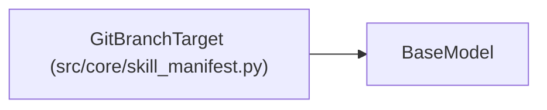

# GitBranchTarget

**Location:** `src/core/skill_manifest.py:712`
**Kind:** Pydantic model
**Bases:** `BaseModel`
**Module:** [skill_manifest](../modules/skill_manifest.md)

## Description

``kind: git_branch`` — promote to a version-control branch
(code-refactor domain; flagged for the X-004 sandbox).

## Model Configuration

| Setting | Value | Source |
|---------|-------|--------|
| `extra` | `'forbid'` | model_config |

## Attributes

| Name | Type | Wire name | Required | Nullable | Default | Constraints | Examples | Description |
|------|------|-----------|----------|----------|---------|-------------|-------------|----------|
| `kind` | `Literal['git_branch']` | `kind` | No | No | `'git_branch'` | — | — | — |
| `repository` | `Optional[str]` | `repository` | No | Yes | `None` | — | — | Repo URL/identifier (G6 placeholders ok). |
| `base_branch` | `str` | `base_branch` | Yes | No | — | — | — | — |
| `target_branch_template` | `Optional[str]` | `proposed_branch_template` | No | Yes | `None` | — | — | — |
| `pr_template` | `Optional[dict[str, Any]]` | `pr_template` | No | Yes | `None` | — | — | — |

## Methods

*No public methods. Inherits from base classes.*

## Relationships

<!-- Auto-generated relationship summary. Do not edit by hand. -->

### Summary

| Module | Methods | Attributes |
|---|---:|---|
| [skill_manifest](../modules/skill_manifest.md) | 0 | `base_branch`, `kind`, `pr_template`, `repository`, `target_branch_template` |

### Structure

| Kind | Entity | Module |
|---|---|---|
| Base | `BaseModel` | — |
