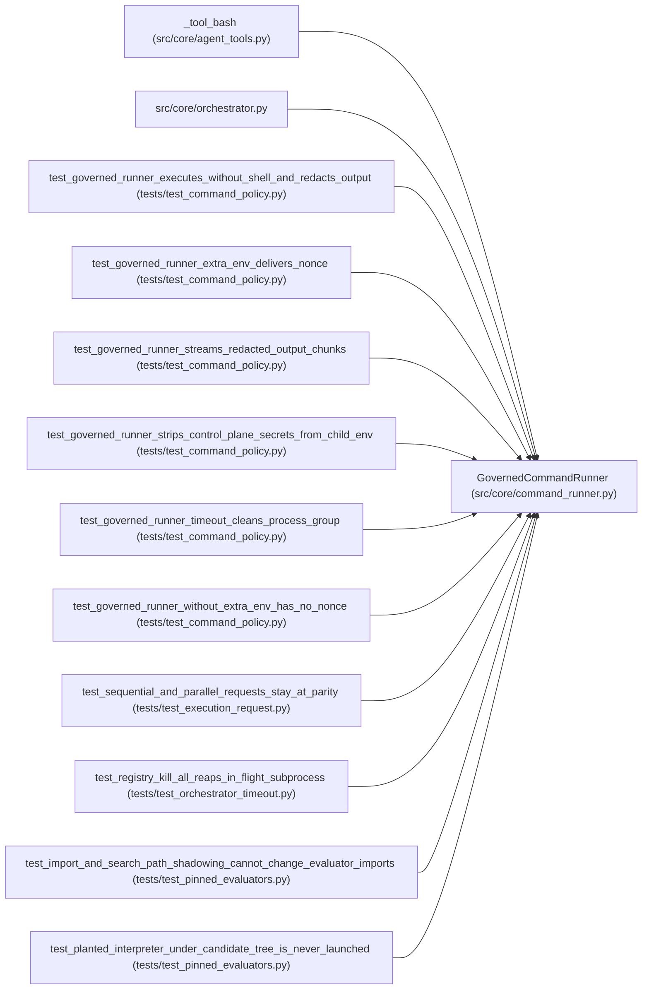

# GovernedCommandRunner

**Location:** `src/core/command_runner.py:323`
**Kind:** Class
**Bases:** —
**Module:** [command_runner](../modules/command_runner.md)

## Description

Validate and execute one approved command without invoking a shell.

## Attributes

*No annotated attributes found.*

## Methods

| Method | Signature | Decorators | Description |
|--------|-----------|------------|-------------|
| `__init__` | `(*, workspace_root: str, session_workspace: str \| None = None, policy_extension: Mapping[str, Any] \| None = None, access: ToolAccessContext \| None = None) -> None` | — | — |
| `run` | `(command: str, *, timeout_s: int, output_callback: OutputCallback \| None = None, proc_registry: CommandProcessRegistry \| None = None, research_id: str \| None = None, extra_env: Mapping[str, str] \| None = None, cwd: str \| None = None, resolved: CommandDecision \| None = None) -> CommandRunResult` | — | Validate and execute one approved command without invoking a shell. |

## Relationships

<!-- Auto-generated relationship summary. Do not edit by hand. -->

### Summary

| Module | Methods | Attributes |
|---|---:|---|
| [command_runner](../modules/command_runner.md) | 2 | — |

### References

| Reference | Kind | Source | Call sites |
|---|---|---|---:|
| `_tool_bash` | call | [agent_tools](../modules/agent_tools.md) | 1 |
| `orchestrator` | import | [orchestrator](../modules/orchestrator.md) | — |
| `test_governed_runner_executes_without_shell_and_redacts_output` | call | [test_command_policy](../modules/test_command_policy.md) | 1 |
| `test_governed_runner_extra_env_delivers_nonce` | call | [test_command_policy](../modules/test_command_policy.md) | 1 |
| `test_governed_runner_streams_redacted_output_chunks` | call | [test_command_policy](../modules/test_command_policy.md) | 1 |
| `test_governed_runner_strips_control_plane_secrets_from_child_env` | call | [test_command_policy](../modules/test_command_policy.md) | 1 |
| `test_governed_runner_timeout_cleans_process_group` | call | [test_command_policy](../modules/test_command_policy.md) | 1 |
| `test_governed_runner_without_extra_env_has_no_nonce` | call | [test_command_policy](../modules/test_command_policy.md) | 1 |
| `test_sequential_and_parallel_requests_stay_at_parity` | call | [test_execution_request](../modules/test_execution_request.md) | 1 |
| `test_registry_kill_all_reaps_in_flight_subprocess` | call | [test_orchestrator_timeout](../modules/test_orchestrator_timeout.md) | 1 |
| `test_import_and_search_path_shadowing_cannot_change_evaluator_imports` | call | [test_pinned_evaluators](../modules/test_pinned_evaluators.md) | 1 |
| `test_planted_interpreter_under_candidate_tree_is_never_launched` | call | [test_pinned_evaluators](../modules/test_pinned_evaluators.md) | 1 |
