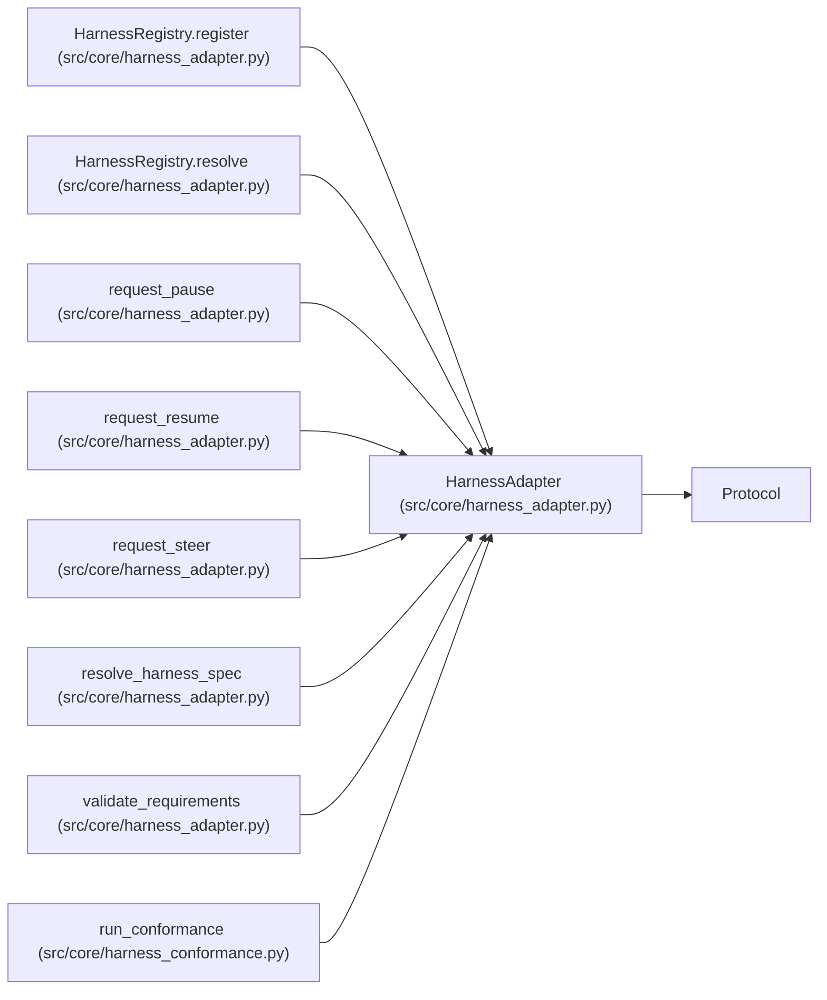

# HarnessAdapter

**Location:** `src/core/harness_adapter.py:31`
**Kind:** Class
**Bases:** `Protocol`
**Module:** [harness_adapter](../modules/harness_adapter.md)

**Decorators:** `@runtime_checkable`

## Description

The minimal, versioned harness surface.

Required operations: identity, capabilities, start/attach, the event
stream, cancel, and close. Optional operations (pause, resume, steer)
exist only for adapters that advertise the matching capability.

## Attributes

*No annotated attributes found.*

## Methods

| Method | Signature | Decorators | Description |
|--------|-----------|------------|-------------|
| `identity` | `() -> HarnessIdentity` | — | — |
| `capabilities` | `() -> frozenset[str]` | — | — |
| `start` | `(request: Mapping[str, Any]) -> Mapping[str, Any]` | — | Begin a run; returns ``{"handle": <id>, ...}``. |
| `attach` | `(request: Mapping[str, Any]) -> Mapping[str, Any]` | — | Rejoin a run under an explicit attach mode. |
| `events` | `(handle: str) -> Iterator[Mapping[str, Any]]` | — | — |
| `cancel` | `(handle: str) -> None` | — | — |
| `close` | `(handle: str) -> None` | — | — |

## Relationships

<!-- Auto-generated relationship summary. Do not edit by hand. -->

### Summary

| Module | Methods | Attributes |
|---|---:|---|
| [harness_adapter](../modules/harness_adapter.md) | 7 | — |

### Structure

| Kind | Entity | Module |
|---|---|---|
| Base | `Protocol` | — |

### References

| Reference | Kind | Source | Call sites |
|---|---|---|---:|
| `HarnessRegistry.register` | type_reference | [harness_adapter](../modules/harness_adapter.md) | — |
| `HarnessRegistry.resolve` | type_reference | [harness_adapter](../modules/harness_adapter.md) | — |
| `request_pause` | type_reference | [harness_adapter](../modules/harness_adapter.md) | — |
| `request_resume` | type_reference | [harness_adapter](../modules/harness_adapter.md) | — |
| `request_steer` | type_reference | [harness_adapter](../modules/harness_adapter.md) | — |
| `resolve_harness_spec` | type_reference | [harness_adapter](../modules/harness_adapter.md) | — |
| `validate_requirements` | type_reference | [harness_adapter](../modules/harness_adapter.md) | — |
| `run_conformance` | type_reference | [harness_conformance](../modules/harness_conformance.md) | — |
