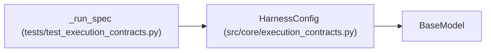

# HarnessConfig

**Location:** `src/core/execution_contracts.py:771`
**Kind:** Pydantic model
**Bases:** `BaseModel`
**Module:** [execution_contracts](../modules/execution_contracts.md)

## Description

Harness identity and effective configuration.

``effective_config`` and ``model_roles`` hold scalar values only — no
harness SDK objects enter a kernel contract.

## Model Configuration

| Setting | Value | Source |
|---------|-------|--------|
| `extra` | `'forbid'` | model_config |

## Attributes

| Name | Type | Wire name | Required | Nullable | Default | Constraints | Examples | Description |
|------|------|-----------|----------|----------|---------|-------------|-------------|----------|
| `adapter_id` | `str` | `adapter_id` | Yes | No | — | min_length=1 | — | — |
| `protocol_version` | `str` | `protocol_version` | Yes | No | — | min_length=1 | — | — |
| `effective_config` | `dict[str, str]` | `effective_config` | No | No | factory: `dict` | — | — | — |
| `model_roles` | `dict[str, str]` | `model_roles` | No | No | factory: `dict` | — | — | — |

## Methods

*No public methods. Inherits from base classes.*

## Relationships

<!-- Auto-generated relationship summary. Do not edit by hand. -->

### Summary

| Module | Methods | Attributes |
|---|---:|---|
| [execution_contracts](../modules/execution_contracts.md) | 0 | `adapter_id`, `effective_config`, `model_roles`, `protocol_version` |

### Structure

| Kind | Entity | Module |
|---|---|---|
| Base | `BaseModel` | — |

### References

| Reference | Kind | Source | Call sites |
|---|---|---|---:|
| `_run_spec` | call | [test_execution_contracts](../modules/test_execution_contracts.md) | 1 |
