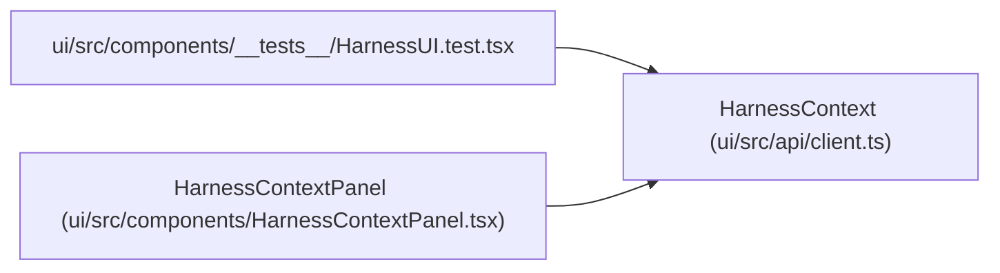

# HarnessContext

**Location:** `ui/src/api/client.ts:700`
**Kind:** Class
**Bases:** —
**Module:** [client](../modules/client.md)

## Description

_Auto-generated from `HarnessContext` in `ui/src/api/client.ts`._

## Attributes

| Name | Type | Required | Default | Description |
|------|------|----------|---------|-------------|
| `research_id` | `string` | Yes | — | — |
| `harness` | `HarnessDescriptor` | Yes | — | — |
| `resume_mode` | `string` | Yes | — | — |
| `evidence` | `{     authority_counts: Record<string, number>;     verified: boolean;     imported: number;   }` | Yes | — | — |
| `candidate_evaluator_context` | `Record<string, unknown>` | Yes | — | — |
| `usage_quality` | `{     cost_known_usd: number;     cost_unknown_events: number;     total_usage_events: number;     cost_status: 'known' \| 'partial' \| 'unknown' \| string;   }` | Yes | — | — |
| `viewer` | `{ kind: string; subject: string; permissions: string[] }` | Yes | — | — |
| `lifecycle` | `{ actions: LifecycleAction[] }` | Yes | — | — |

## Methods

*No public methods. Inherits from base classes.*

## Relationships

<!-- Auto-generated relationship summary. Do not edit by hand. -->

### Summary

| Module | Methods | Attributes |
|---|---:|---|
| [client](../modules/client.md) | 0 | `candidate_evaluator_context`, `evidence`, `harness`, `lifecycle`, `research_id`, `resume_mode`, `usage_quality`, `viewer` |

### References

| Reference | Kind | Source | Call sites |
|---|---|---|---:|
| `HarnessUI.test` | import | [HarnessUI.test](../modules/HarnessUI.test.md) | — |
| `HarnessContextPanel` | type_reference | [HarnessContextPanel](../modules/HarnessContextPanel.md) | — |
