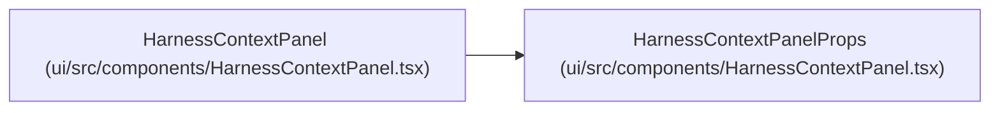

# HarnessContextPanelProps

**Location:** `ui/src/components/HarnessContextPanel.tsx:7`
**Kind:** Class
**Bases:** —
**Module:** [HarnessContextPanel](../modules/HarnessContextPanel.md)

## Description

_Auto-generated from `HarnessContextPanelProps` in `ui/src/components/HarnessContextPanel.tsx`._

## Attributes

| Name | Type | Required | Default | Description |
|------|------|----------|---------|-------------|
| `context` | `HarnessContext` | Yes | — | — |
| `onAction` | `(action: string) => void` | No | — | — |

## Methods

*No public methods. Inherits from base classes.*

## Relationships

<!-- Auto-generated relationship summary. Do not edit by hand. -->

### Summary

| Module | Methods | Attributes |
|---|---:|---|
| [HarnessContextPanel](../modules/HarnessContextPanel.md) | 0 | `context`, `onAction` |

### References

| Reference | Kind | Source | Call sites |
|---|---|---|---:|
| `HarnessContextPanel` | type_reference | [HarnessContextPanel](../modules/HarnessContextPanel.md) | — |
