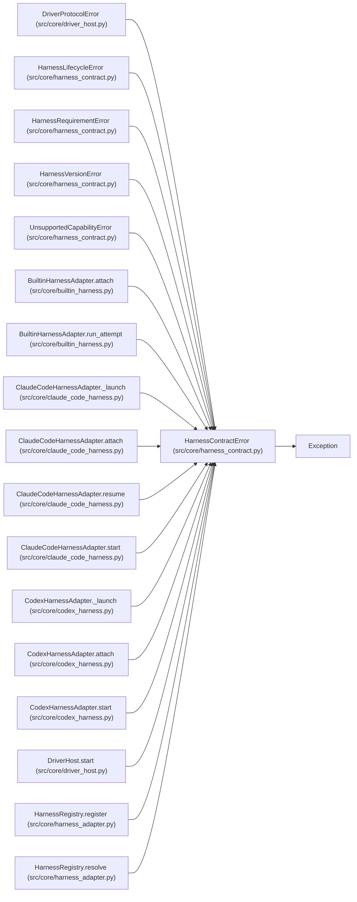

# HarnessContractError

**Location:** `src/core/harness_contract.py:74`
**Kind:** Class
**Bases:** `Exception`
**Module:** [harness_contract](../modules/harness_contract.md)

## Description

The harness contract was violated or cannot be honored.

## Attributes

*No annotated attributes found.*

## Methods

*No public methods. Inherits from base classes.*

## Relationships

<!-- Auto-generated relationship summary. Do not edit by hand. -->

### Summary

| Module | Methods | Attributes |
|---|---:|---|
| [harness_contract](../modules/harness_contract.md) | 0 | — |

### Structure

| Kind | Entity | Module |
|---|---|---|
| Base | `Exception` | — |
| Subclass | `DriverProtocolError` | [driver_host](../modules/driver_host.md) |
| Subclass | `HarnessLifecycleError` | [harness_contract](../modules/harness_contract.md) |
| Subclass | `HarnessRequirementError` | [harness_contract](../modules/harness_contract.md) |
| Subclass | `HarnessVersionError` | [harness_contract](../modules/harness_contract.md) |
| Subclass | `UnsupportedCapabilityError` | [harness_contract](../modules/harness_contract.md) |

### References

| Reference | Kind | Source | Call sites |
|---|---|---|---:|
| `BuiltinHarnessAdapter.attach` | call | [builtin_harness](../modules/builtin_harness.md) | 1 |
| `BuiltinHarnessAdapter.run_attempt` | call | [builtin_harness](../modules/builtin_harness.md) | 1 |
| `ClaudeCodeHarnessAdapter._launch` | call | [claude_code_harness](../modules/claude_code_harness.md) | 1 |
| `ClaudeCodeHarnessAdapter.attach` | call | [claude_code_harness](../modules/claude_code_harness.md) | 1 |
| `ClaudeCodeHarnessAdapter.resume` | call | [claude_code_harness](../modules/claude_code_harness.md) | 1 |
| `ClaudeCodeHarnessAdapter.start` | call | [claude_code_harness](../modules/claude_code_harness.md) | 1 |
| `CodexHarnessAdapter._launch` | call | [codex_harness](../modules/codex_harness.md) | 1 |
| `CodexHarnessAdapter.attach` | call | [codex_harness](../modules/codex_harness.md) | 1 |
| `CodexHarnessAdapter.start` | call | [codex_harness](../modules/codex_harness.md) | 1 |
| `DriverHost.start` | call | [driver_host](../modules/driver_host.md) | 1 |
| `HarnessRegistry.register` | call | [harness_adapter](../modules/harness_adapter.md) | 3 |
| `HarnessRegistry.resolve` | call | [harness_adapter](../modules/harness_adapter.md) | 1 |

> References: showing 12 of 19 logical references; 7 omitted by the 12-row generated summary limit.
