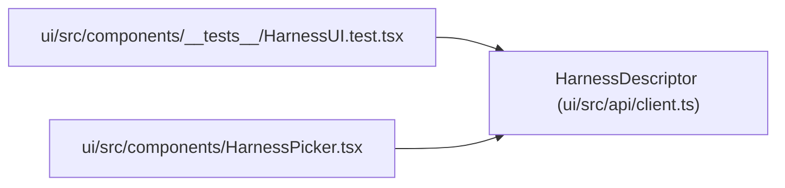

# HarnessDescriptor

**Location:** `ui/src/api/client.ts:680`
**Kind:** Class
**Bases:** —
**Module:** [client](../modules/client.md)

## Description

_Auto-generated from `HarnessDescriptor` in `ui/src/api/client.ts`._

## Attributes

| Name | Type | Required | Default | Description |
|------|------|----------|---------|-------------|
| `name` | `string` | Yes | — | — |
| `version` | `string` | Yes | — | — |
| `contract_version` | `string` | Yes | — | — |
| `interface` | `string` | No | — | — |
| `schema_pin` | `string` | No | — | — |
| `capabilities` | `string[]` | Yes | — | — |
| `unsupported_capabilities` | `HarnessCapabilityEntry[]` | Yes | — | — |
| `attach_modes` | `string[]` | No | — | — |
| `resume_mode` | `string` | No | — | — |
| `permissions` | `Record<string, boolean>` | No | — | — |
| `preflight` | `{ checks: HarnessPreflightCheck[] }` | Yes | — | — |

## Methods

*No public methods. Inherits from base classes.*

## Relationships

<!-- Auto-generated relationship summary. Do not edit by hand. -->

### Summary

| Module | Methods | Attributes |
|---|---:|---|
| [client](../modules/client.md) | 0 | `attach_modes`, `capabilities`, `contract_version`, `interface`, `name`, `permissions`, `preflight`, `resume_mode`, `schema_pin`, `unsupported_capabilities`, `version` |

### References

| Reference | Kind | Source | Call sites |
|---|---|---|---:|
| `HarnessUI.test` | import | [HarnessUI.test](../modules/HarnessUI.test.md) | — |
| `HarnessPicker` | import | [HarnessPicker](../modules/HarnessPicker.md) | — |
