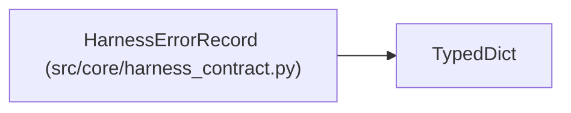

# HarnessErrorRecord

**Location:** `src/core/harness_contract.py:65`
**Kind:** Class
**Bases:** `TypedDict`
**Module:** [harness_contract](../modules/harness_contract.md)

## Description

A harness error surfaced as data, with honest retry semantics.

## Attributes

| Name | Type | Presence | Description |
|------|------|----------|-------------|
| `code` | `str` | *required* | — |
| `message` | `str` | *required* | — |
| `retryable` | `bool` | *required* | — |
| `details` | `Mapping[str, Any]` | *required* | — |

## Methods

*No public methods. Inherits from base classes.*

## Relationships

<!-- Auto-generated relationship summary. Do not edit by hand. -->

### Summary

| Module | Methods | Attributes |
|---|---:|---|
| [harness_contract](../modules/harness_contract.md) | 0 | `code`, `details`, `message`, `retryable` |

### Structure

| Kind | Entity | Module |
|---|---|---|
| Base | `TypedDict` | — |
