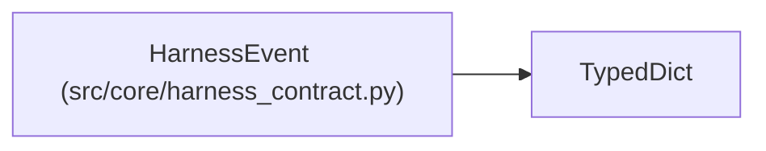

# HarnessEvent

**Location:** `src/core/harness_contract.py:45`
**Kind:** Class
**Bases:** `TypedDict`
**Module:** [harness_contract](../modules/harness_contract.md)

## Description

One event from a harness's stream; unknown types are tolerated.

## Attributes

| Name | Type | Presence | Description |
|------|------|----------|-------------|
| `event_id` | `str` | *optional* | — |
| `type` | `str` | *optional* | — |
| `sequence` | `int` | *optional* | — |
| `timestamp` | `str` | *optional* | — |
| `payload` | `Mapping[str, Any]` | *optional* | — |
| `unknown` | `bool` | *optional* | — |

## Methods

*No public methods. Inherits from base classes.*

## Relationships

<!-- Auto-generated relationship summary. Do not edit by hand. -->

### Summary

| Module | Methods | Attributes |
|---|---:|---|
| [harness_contract](../modules/harness_contract.md) | 0 | `event_id`, `payload`, `sequence`, `timestamp`, `type`, `unknown` |

### Structure

| Kind | Entity | Module |
|---|---|---|
| Base | `TypedDict` | — |
