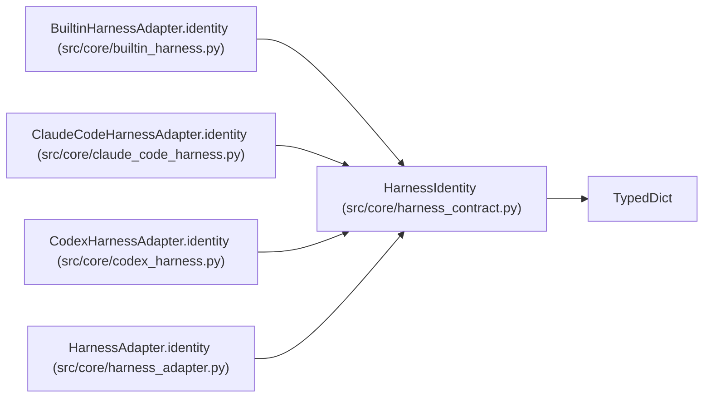

# HarnessIdentity

**Location:** `src/core/harness_contract.py:32`
**Kind:** Class
**Bases:** `TypedDict`
**Module:** [harness_contract](../modules/harness_contract.md)

## Description

Who the adapter is and what it is allowed to do.

## Attributes

| Name | Type | Presence | Description |
|------|------|----------|-------------|
| `name` | `str` | *required* | — |
| `version` | `str` | *required* | — |
| `contract_version` | `str` | *required* | — |
| `permissions` | `Mapping[str, Any]` | *required* | — |
| `interface` | `NotRequired[str]` | *optional* | — |
| `schema_pin` | `NotRequired[str]` | *optional* | — |
| `attach_modes` | `NotRequired[list[str]]` | *optional* | — |
| `resume_mode` | `NotRequired[str]` | *optional* | — |

## Methods

*No public methods. Inherits from base classes.*

## Relationships

<!-- Auto-generated relationship summary. Do not edit by hand. -->

### Summary

| Module | Methods | Attributes |
|---|---:|---|
| [harness_contract](../modules/harness_contract.md) | 0 | `attach_modes`, `contract_version`, `interface`, `name`, `permissions`, `resume_mode`, `schema_pin`, `version` |

### Structure

| Kind | Entity | Module |
|---|---|---|
| Base | `TypedDict` | — |

### References

| Reference | Kind | Source | Call sites |
|---|---|---|---:|
| `BuiltinHarnessAdapter.identity` | type_reference | [builtin_harness](../modules/builtin_harness.md) | — |
| `ClaudeCodeHarnessAdapter.identity` | type_reference | [claude_code_harness](../modules/claude_code_harness.md) | — |
| `CodexHarnessAdapter.identity` | type_reference | [codex_harness](../modules/codex_harness.md) | — |
| `HarnessAdapter.identity` | type_reference | [harness_adapter](../modules/harness_adapter.md) | — |
