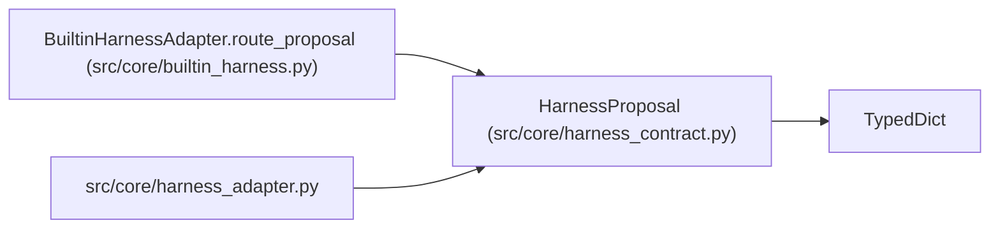

# HarnessProposal

**Location:** `src/core/harness_contract.py:56`
**Kind:** Class
**Bases:** `TypedDict`
**Module:** [harness_contract](../modules/harness_contract.md)

## Description

A proposal carried across the boundary (e.g. a steering proposal).

## Attributes

| Name | Type | Presence | Description |
|------|------|----------|-------------|
| `proposal_id` | `str` | *required* | — |
| `kind` | `str` | *required* | — |
| `target` | `str` | *required* | — |
| `payload` | `Mapping[str, Any]` | *required* | — |

## Methods

*No public methods. Inherits from base classes.*

## Relationships

<!-- Auto-generated relationship summary. Do not edit by hand. -->

### Summary

| Module | Methods | Attributes |
|---|---:|---|
| [harness_contract](../modules/harness_contract.md) | 0 | `kind`, `payload`, `proposal_id`, `target` |

### Structure

| Kind | Entity | Module |
|---|---|---|
| Base | `TypedDict` | — |

### References

| Reference | Kind | Source | Call sites |
|---|---|---|---:|
| `BuiltinHarnessAdapter.route_proposal` | type_reference | [builtin_harness](../modules/builtin_harness.md) | — |
| `harness_adapter` | import | [harness_adapter](../modules/harness_adapter.md) | — |
