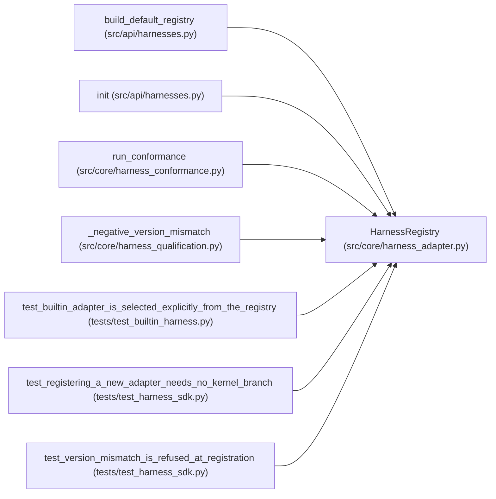

# HarnessRegistry

**Location:** `src/core/harness_adapter.py:63`
**Kind:** Class
**Bases:** —
**Module:** [harness_adapter](../modules/harness_adapter.md)

## Description

Name → adapter. Registering requires no kernel branch for the name.

## Attributes

*No annotated attributes found.*

## Methods

| Method | Signature | Decorators | Description |
|--------|-----------|------------|-------------|
| `__init__` | `() -> None` | — | — |
| `register` | `(adapter: HarnessAdapter) -> None` | — | — |
| `resolve` | `(name: str) -> HarnessAdapter` | — | — |
| `names` | `() -> tuple[str, ...]` | — | — |

## Relationships

<!-- Auto-generated relationship summary. Do not edit by hand. -->

### Summary

| Module | Methods | Attributes |
|---|---:|---|
| [harness_adapter](../modules/harness_adapter.md) | 4 | — |

### References

| Reference | Kind | Source | Call sites |
|---|---|---|---:|
| `build_default_registry` | call | [harnesses](../modules/harnesses.md) | 1 |
| `build_default_registry` | type_reference | [harnesses](../modules/harnesses.md) | — |
| `init` | type_reference | [harnesses](../modules/harnesses.md) | — |
| `run_conformance` | call | [harness_conformance](../modules/harness_conformance.md) | 1 |
| `_negative_version_mismatch` | call | [harness_qualification](../modules/harness_qualification.md) | 1 |
| `test_builtin_adapter_is_selected_explicitly_from_the_registry` | call | [test_builtin_harness](../modules/test_builtin_harness.md) | 1 |
| `test_registering_a_new_adapter_needs_no_kernel_branch` | call | [test_harness_sdk](../modules/test_harness_sdk.md) | 1 |
| `test_version_mismatch_is_refused_at_registration` | call | [test_harness_sdk](../modules/test_harness_sdk.md) | 1 |
