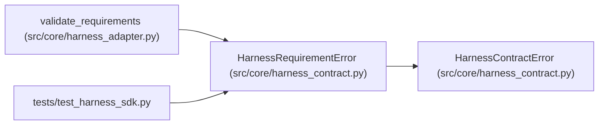

# HarnessRequirementError

**Location:** `src/core/harness_contract.py:98`
**Kind:** Class
**Bases:** `HarnessContractError`
**Module:** [harness_contract](../modules/harness_contract.md)

## Description

Skill/operator requirements exceed what the adapter provides.

## Attributes

*No annotated attributes found.*

## Methods

| Method | Signature | Decorators | Description |
|--------|-----------|------------|-------------|
| `__init__` | `(missing: Mapping[str, Any]) -> None` | — | — |

## Relationships

<!-- Auto-generated relationship summary. Do not edit by hand. -->

### Summary

| Module | Methods | Attributes |
|---|---:|---|
| [harness_contract](../modules/harness_contract.md) | 1 | — |

### Structure

| Kind | Entity | Module |
|---|---|---|
| Base | `HarnessContractError` | [harness_contract](../modules/harness_contract.md) |

### References

| Reference | Kind | Source | Call sites |
|---|---|---|---:|
| `validate_requirements` | call | [harness_adapter](../modules/harness_adapter.md) | 1 |
| `test_harness_sdk` | import | [test_harness_sdk](../modules/test_harness_sdk.md) | — |
