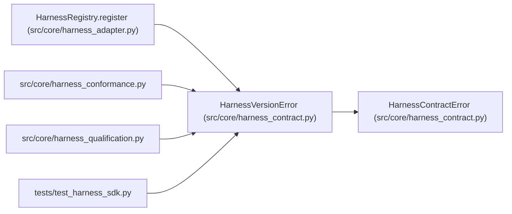

# HarnessVersionError

**Location:** `src/core/harness_contract.py:78`
**Kind:** Class
**Bases:** `HarnessContractError`
**Module:** [harness_contract](../modules/harness_contract.md)

## Description

The adapter's contract version is incompatible with this SDK.

## Attributes

*No annotated attributes found.*

## Methods

*No public methods. Inherits from base classes.*

## Relationships

<!-- Auto-generated relationship summary. Do not edit by hand. -->

### Summary

| Module | Methods | Attributes |
|---|---:|---|
| [harness_contract](../modules/harness_contract.md) | 0 | — |

### Structure

| Kind | Entity | Module |
|---|---|---|
| Base | `HarnessContractError` | [harness_contract](../modules/harness_contract.md) |

### References

| Reference | Kind | Source | Call sites |
|---|---|---|---:|
| `HarnessRegistry.register` | call | [harness_adapter](../modules/harness_adapter.md) | 1 |
| `harness_conformance` | import | [harness_conformance](../modules/harness_conformance.md) | — |
| `harness_qualification` | import | [harness_qualification](../modules/harness_qualification.md) | — |
| `test_harness_sdk` | import | [test_harness_sdk](../modules/test_harness_sdk.md) | — |
