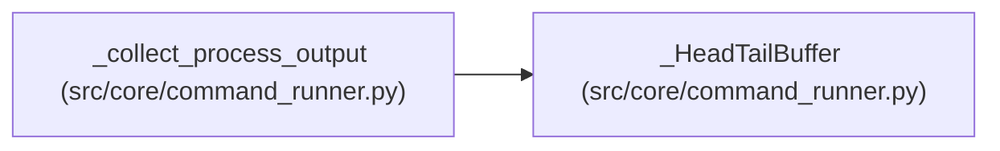

# _HeadTailBuffer

**Location:** `src/core/command_runner.py:36`
**Kind:** Class
**Bases:** —
**Module:** [command_runner](../modules/command_runner.md)

## Description

Retain a fixed-size head and rolling tail, including for newline-free data.

>>> buf = _HeadTailBuffer(8)
>>> buf.append("abc")
>>> buf.append("defgh")
>>> buf.getvalue()
'abcdefgh'
>>> buf.append("ijklmnop")
>>> buf.getvalue() == "abcd" + _TRUNCATION_MARKER + "mnop"
True
>>> len(buf.head) + len(buf.tail) <= 8
True

## Attributes

*No annotated attributes found.*

## Methods

| Method | Signature | Decorators | Description |
|--------|-----------|------------|-------------|
| `__init__` | `(limit: int = _MAX_OUTPUT_LEN) -> None` | — | — |
| `append` | `(text: str) -> None` | — | — |
| `getvalue` | `() -> str` | — | — |

## Relationships

<!-- Auto-generated relationship summary. Do not edit by hand. -->

### Summary

| Module | Methods | Attributes |
|---|---:|---|
| [command_runner](../modules/command_runner.md) | 3 | — |

### References

| Reference | Kind | Source | Call sites |
|---|---|---|---:|
| `_collect_process_output` | call | [command_runner](../modules/command_runner.md) | 1 |
