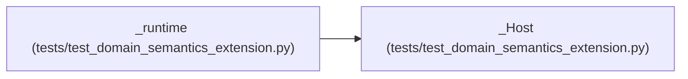

# _Host

**Location:** `tests/test_domain_semantics_extension.py:53`
**Kind:** Class
**Bases:** —
**Module:** [test_domain_semantics_extension](../modules/test_domain_semantics_extension.md)

## Description

Minimal SkillHostServices stand-in for runtime construction.

## Attributes

*No annotated attributes found.*

## Methods

| Method | Signature | Decorators | Description |
|--------|-----------|------------|-------------|
| `load_claude_md` | `() -> str` | — | — |
| `load_research_resume` | `(config: Any) -> str` | — | — |
| `build_phase_contract_block` | `(config: Any) -> str` | — | — |
| `research_resume_path` | `(config: Any) -> str` | — | — |

## Relationships

<!-- Auto-generated relationship summary. Do not edit by hand. -->

### Summary

| Module | Methods | Attributes |
|---|---:|---|
| [test_domain_semantics_extension](../modules/test_domain_semantics_extension.md) | 4 | — |

### References

| Reference | Kind | Source | Call sites |
|---|---|---|---:|
| `_runtime` | call | [test_domain_semantics_extension](../modules/test_domain_semantics_extension.md) | 1 |
