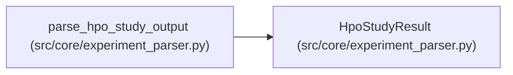

# HpoStudyResult

**Location:** `src/core/experiment_parser.py:85`
**Kind:** Class
**Bases:** —
**Module:** [experiment_parser](../modules/experiment_parser.md)

**Decorators:** `@dataclass`

## Description

Parsed HPO study output from prepare.py --hpo mode.

## Attributes

| Name | Type | Default | Description |
|------|------|---------|-------------|
| `status` | `str` | `'unknown'` | — |
| `n_trials` | `int` | `0` | — |
| `completed_trials` | `int` | `0` | — |
| `best_composite` | `Optional[float]` | `None` | — |
| `training_time_s` | `Optional[float]` | `None` | — |
| `top_trials` | `List[HpoTrialResult]` | `field(default_factory=list)` | — |
| `extra` | `Dict[str, Any]` | `field(default_factory=dict)` | — |

## Methods

| Method | Signature | Decorators | Description |
|--------|-----------|------------|-------------|
| `to_dict` | `() -> Dict[str, Any]` | — | — |

## Relationships

<!-- Auto-generated relationship summary. Do not edit by hand. -->

### Summary

| Module | Methods | Attributes |
|---|---:|---|
| [experiment_parser](../modules/experiment_parser.md) | 1 | `best_composite`, `completed_trials`, `extra`, `n_trials`, `status`, `top_trials`, `training_time_s` |

### References

| Reference | Kind | Source | Call sites |
|---|---|---|---:|
| `parse_hpo_study_output` | call | [experiment_parser](../modules/experiment_parser.md) | 1 |
| `parse_hpo_study_output` | type_reference | [experiment_parser](../modules/experiment_parser.md) | — |
