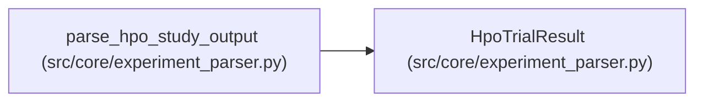

# HpoTrialResult

**Location:** `src/core/experiment_parser.py:74`
**Kind:** Class
**Bases:** —
**Module:** [experiment_parser](../modules/experiment_parser.md)

**Decorators:** `@dataclass`

## Description

A single trial from an HPO study.

## Attributes

| Name | Type | Default | Description |
|------|------|---------|-------------|
| `rank` | `int` | *required* | — |
| `trial_number` | `int` | *required* | — |
| `composite_score` | `float` | *required* | — |
| `params` | `Dict[str, Any]` | `field(default_factory=dict)` | — |
| `metrics` | `Dict[str, float]` | `field(default_factory=dict)` | — |

## Methods

*No public methods. Inherits from base classes.*

## Relationships

<!-- Auto-generated relationship summary. Do not edit by hand. -->

### Summary

| Module | Methods | Attributes |
|---|---:|---|
| [experiment_parser](../modules/experiment_parser.md) | 0 | `composite_score`, `metrics`, `params`, `rank`, `trial_number` |

### References

| Reference | Kind | Source | Call sites |
|---|---|---|---:|
| `parse_hpo_study_output` | call | [experiment_parser](../modules/experiment_parser.md) | 1 |
