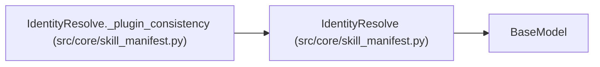

# IdentityResolve

**Location:** `src/core/skill_manifest.py:910`
**Kind:** Pydantic model
**Bases:** `BaseModel`
**Module:** [skill_manifest](../modules/skill_manifest.md)

## Description

``trial_identity.resolve`` — the G2 plugin selector. ``mode=declarative``
means ``hash_fields`` hash is sufficient; ``mode=plugin`` delegates the
multi-source synthesis (``data_split_id`` / ``seed`` / ``validation_mode``
probes) that ``iteration_snapshot.build_trial_identity`` performs today to a
sandboxed ``resolve_identity.py``.

## Model Configuration

| Setting | Value | Source |
|---------|-------|--------|
| `extra` | `'forbid'` | model_config |

## Validators

| Method | Scope | Fields | Mode | Options |
|--------|-------|--------|------|---------|
| `_plugin_consistency` | model | — | after | — |

## Attributes

| Name | Type | Wire name | Required | Nullable | Default | Constraints | Examples | Description |
|------|------|-----------|----------|----------|---------|-------------|-------------|----------|
| `mode` | `IdentityResolveMode` | `mode` | No | No | `'declarative'` | — | — | — |
| `plugin` | `Optional[str]` | `plugin` | No | Yes | `None` | — | — | Relative path of ``resolve_identity.py`` (mode=plugin only). |

## Methods

| Method | Signature | Decorators | Description |
|--------|-----------|------------|-------------|
| `_plugin_consistency` | `() -> 'IdentityResolve'` | `@model_validator(mode='after')` | — |

## Relationships

<!-- Auto-generated relationship summary. Do not edit by hand. -->

### Summary

| Module | Methods | Attributes |
|---|---:|---|
| [skill_manifest](../modules/skill_manifest.md) | 1 | `mode`, `plugin` |

### Structure

| Kind | Entity | Module |
|---|---|---|
| Base | `BaseModel` | — |

### References

| Reference | Kind | Source | Call sites |
|---|---|---|---:|
| `IdentityResolve._plugin_consistency` | type_reference | [skill_manifest](../modules/skill_manifest.md) | — |
