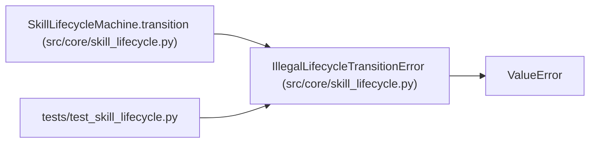

# IllegalLifecycleTransitionError

**Location:** `src/core/skill_lifecycle.py:85`
**Kind:** Class
**Bases:** `ValueError`
**Module:** [skill_lifecycle](../modules/skill_lifecycle.md)

## Description

Raised when a (state, event) pair is not a legal transition.

## Attributes

*No annotated attributes found.*

## Methods

| Method | Signature | Decorators | Description |
|--------|-----------|------------|-------------|
| `__init__` | `(skill_id: str, from_state: SkillLifecycleState, event: SkillLifecycleEvent) -> None` | — | — |

## Relationships

<!-- Auto-generated relationship summary. Do not edit by hand. -->

### Summary

| Module | Methods | Attributes |
|---|---:|---|
| [skill_lifecycle](../modules/skill_lifecycle.md) | 1 | — |

### Structure

| Kind | Entity | Module |
|---|---|---|
| Base | `ValueError` | — |

### References

| Reference | Kind | Source | Call sites |
|---|---|---|---:|
| `SkillLifecycleMachine.transition` | call | [skill_lifecycle](../modules/skill_lifecycle.md) | 1 |
| `test_skill_lifecycle` | import | [test_skill_lifecycle](../modules/test_skill_lifecycle.md) | — |
