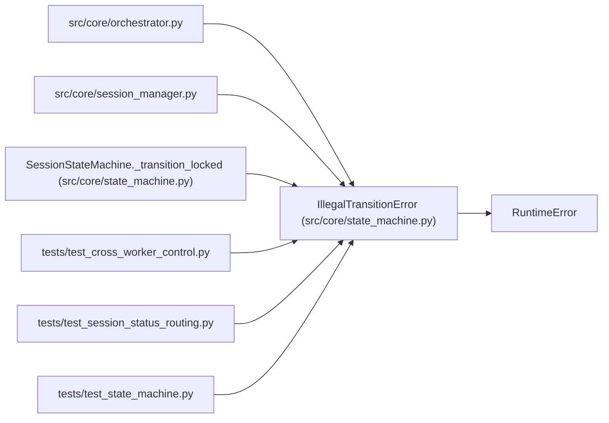

# IllegalTransitionError

**Location:** `src/core/state_machine.py:124`
**Kind:** Class
**Bases:** `RuntimeError`
**Module:** [state_machine](../modules/state_machine.md)

## Description

Raised when an event is not legal from the session's current state.

Carries the ``(from_state, event)`` pair so callers can react — most
importantly the orchestrator exit path, which catches a ``complete``
refused by a racing stop and skips auto-promotion (ARC-011 §5 / §8).

## Attributes

*No annotated attributes found.*

## Methods

| Method | Signature | Decorators | Description |
|--------|-----------|------------|-------------|
| `__init__` | `(from_state: SessionState, event: SessionEvent) -> None` | — | — |

## Relationships

<!-- Auto-generated relationship summary. Do not edit by hand. -->

### Summary

| Module | Methods | Attributes |
|---|---:|---|
| [state_machine](../modules/state_machine.md) | 1 | — |

### Structure

| Kind | Entity | Module |
|---|---|---|
| Base | `RuntimeError` | — |

### References

| Reference | Kind | Source | Call sites |
|---|---|---|---:|
| `orchestrator` | import | [orchestrator](../modules/orchestrator.md) | — |
| `session_manager` | import | [session_manager](../modules/session_manager.md) | — |
| `SessionStateMachine._transition_locked` | call | [state_machine](../modules/state_machine.md) | 2 |
| `test_cross_worker_control` | import | [test_cross_worker_control](../modules/test_cross_worker_control.md) | — |
| `test_session_status_routing` | import | [test_session_status_routing](../modules/test_session_status_routing.md) | — |
| `test_state_machine` | import | [test_state_machine](../modules/test_state_machine.md) | — |
