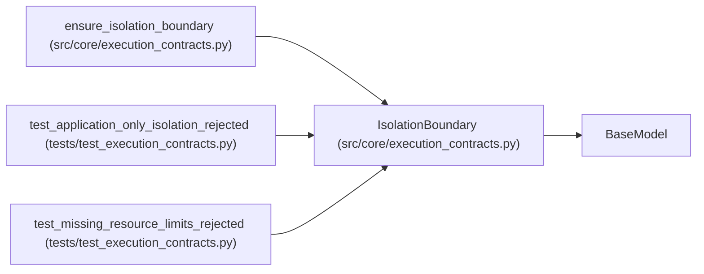

# IsolationBoundary

**Location:** `src/core/execution_contracts.py:516`
**Kind:** Pydantic model
**Bases:** `BaseModel`
**Module:** [execution_contracts](../modules/execution_contracts.md)

## Description

Declared enforcement boundary for untrusted execution.

The qualified boundary is Linux with operating-system enforcement.
Application-only checks do not confine hostile code and are rejected
wherever an enforced boundary is required.

## Model Configuration

| Setting | Value | Source |
|---------|-------|--------|
| `extra` | `'forbid'` | model_config |

## Attributes

| Name | Type | Wire name | Required | Nullable | Default | Constraints | Examples | Description |
|------|------|-----------|----------|----------|---------|-------------|-------------|----------|
| `platform` | `Literal['linux']` | `platform` | Yes | No | — | — | — | — |
| `enforcement` | `Literal['os', 'application']` | `enforcement` | Yes | No | — | — | — | — |
| `process_isolation` | `bool` | `process_isolation` | Yes | No | — | — | — | — |
| `filesystem_confinement` | `bool` | `filesystem_confinement` | Yes | No | — | — | — | — |
| `network_policy` | `bool` | `network_policy` | Yes | No | — | — | — | — |
| `resource_limits` | `bool` | `resource_limits` | Yes | No | — | — | — | — |

## Methods

*No public methods. Inherits from base classes.*

## Relationships

<!-- Auto-generated relationship summary. Do not edit by hand. -->

### Summary

| Module | Methods | Attributes |
|---|---:|---|
| [execution_contracts](../modules/execution_contracts.md) | 0 | `enforcement`, `filesystem_confinement`, `network_policy`, `platform`, `process_isolation`, `resource_limits` |

### Structure

| Kind | Entity | Module |
|---|---|---|
| Base | `BaseModel` | — |

### References

| Reference | Kind | Source | Call sites |
|---|---|---|---:|
| `ensure_isolation_boundary` | type_reference | [execution_contracts](../modules/execution_contracts.md) | — |
| `test_application_only_isolation_rejected` | call | [test_execution_contracts](../modules/test_execution_contracts.md) | 1 |
| `test_missing_resource_limits_rejected` | call | [test_execution_contracts](../modules/test_execution_contracts.md) | 1 |
