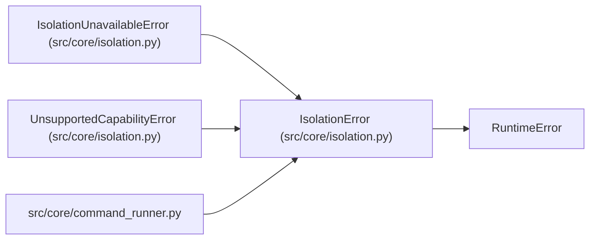

# IsolationError

**Location:** `src/core/isolation.py:53`
**Kind:** Class
**Bases:** `RuntimeError`
**Module:** [isolation](../modules/isolation.md)

## Description

Base class for isolation boundary failures (always fail-closed).

## Attributes

*No annotated attributes found.*

## Methods

*No public methods. Inherits from base classes.*

## Relationships

<!-- Auto-generated relationship summary. Do not edit by hand. -->

### Summary

| Module | Methods | Attributes |
|---|---:|---|
| [isolation](../modules/isolation.md) | 0 | — |

### Structure

| Kind | Entity | Module |
|---|---|---|
| Base | `RuntimeError` | — |
| Subclass | `IsolationUnavailableError` | [isolation](../modules/isolation.md) |
| Subclass | `UnsupportedCapabilityError` | [isolation](../modules/isolation.md) |

### References

| Reference | Kind | Source | Call sites |
|---|---|---|---:|
| `command_runner` | import | [command_runner](../modules/command_runner.md) | — |
