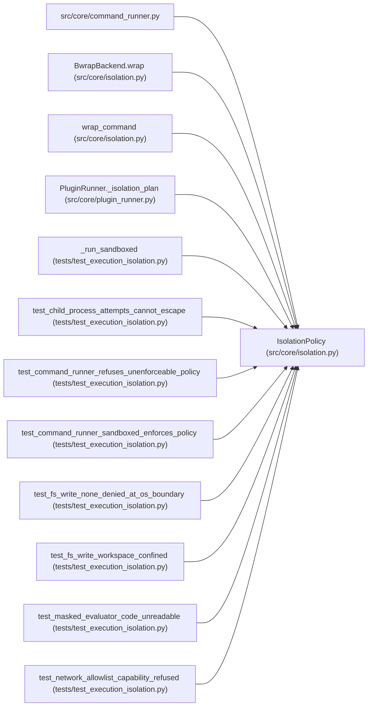

# IsolationPolicy

**Location:** `src/core/isolation.py:66`
**Kind:** Class
**Bases:** —
**Module:** [isolation](../modules/isolation.md)

**Decorators:** `@dataclass(frozen=True)`

## Description

The declared boundary for one candidate-controlled subprocess.

``fs_write`` is enforced at the mount layer (``none`` = read-only
everywhere, ``workspace`` = writable session workspace only);
``network`` is enforced at the network namespace (``deny`` is the only
enforceable mode — see the module docstring). Read roots are mounted
read-only; nothing outside the declared roots is visible.

## Attributes

| Name | Type | Default | Description |
|------|------|---------|-------------|
| `fs_write` | `Literal['none', 'workspace']` | `'none'` | — |
| `network_egress` | `tuple[str, ...]` | `()` | — |
| `read_roots` | `tuple[str, ...]` | `()` | — |
| `write_roots` | `tuple[str, ...]` | `()` | — |
| `masked_roots` | `tuple[str, ...]` | `()` | — |
| `cwd` | `Optional[str]` | `None` | — |

## Methods

*No public methods. Inherits from base classes.*

## Relationships

<!-- Auto-generated relationship summary. Do not edit by hand. -->

### Summary

| Module | Methods | Attributes |
|---|---:|---|
| [isolation](../modules/isolation.md) | 0 | `cwd`, `fs_write`, `masked_roots`, `network_egress`, `read_roots`, `write_roots` |

### References

| Reference | Kind | Source | Call sites |
|---|---|---|---:|
| `command_runner` | import | [command_runner](../modules/command_runner.md) | — |
| `BwrapBackend.wrap` | type_reference | [isolation](../modules/isolation.md) | — |
| `wrap_command` | type_reference | [isolation](../modules/isolation.md) | — |
| `PluginRunner._isolation_plan` | call | [plugin_runner](../modules/plugin_runner.md) | 1 |
| `_run_sandboxed` | type_reference | [test_execution_isolation](../modules/test_execution_isolation.md) | — |
| `test_child_process_attempts_cannot_escape` | call | [test_execution_isolation](../modules/test_execution_isolation.md) | 1 |
| `test_command_runner_refuses_unenforceable_policy` | call | [test_execution_isolation](../modules/test_execution_isolation.md) | 1 |
| `test_command_runner_sandboxed_enforces_policy` | call | [test_execution_isolation](../modules/test_execution_isolation.md) | 1 |
| `test_fs_write_none_denied_at_os_boundary` | call | [test_execution_isolation](../modules/test_execution_isolation.md) | 1 |
| `test_fs_write_workspace_confined` | call | [test_execution_isolation](../modules/test_execution_isolation.md) | 1 |
| `test_masked_evaluator_code_unreadable` | call | [test_execution_isolation](../modules/test_execution_isolation.md) | 1 |
| `test_network_allowlist_capability_refused` | call | [test_execution_isolation](../modules/test_execution_isolation.md) | 1 |

> References: showing 12 of 13 logical references; 1 omitted by the 12-row generated summary limit.
