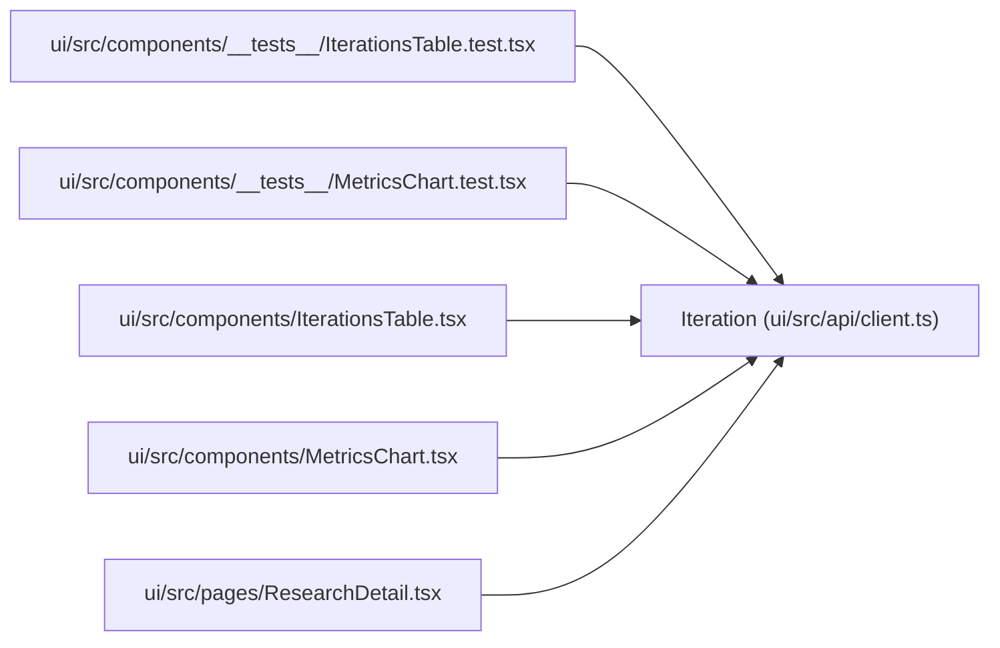

# Iteration

**Location:** `ui/src/api/client.ts:50`
**Kind:** Class
**Bases:** —
**Module:** [client](../modules/client.md)

## Description

_Auto-generated from `Iteration` in `ui/src/api/client.ts`._

## Attributes

| Name | Type | Required | Default | Description |
|------|------|----------|---------|-------------|
| `id` | `number` | Yes | — | — |
| `research_id` | `string` | Yes | — | — |
| `iteration` | `number` | Yes | — | — |
| `primary_metric` | `number \| null` | Yes | — | — |
| `metric_name` | `string` | Yes | — | — |
| `training_gates_passed` | `boolean` | No | — | — |
| `all_gates_passed` | `boolean` | Yes | — | — |
| `consistency_report_passed` | `boolean` | No | — | — |
| `decision` | `string` | Yes | — | — |
| `config_snapshot` | `string \| null` | Yes | — | — |
| `metrics_json` | `string \| null` | Yes | — | — |
| `created_at` | `string` | Yes | — | — |
| `metrics` | `Record<string, unknown>` | Yes | — | — |
| `mlflow_run_id` | `string` | Yes | — | — |
| `mlflow_url` | `string \| null` | Yes | — | — |
| `model_version` | `string \| null` | Yes | — | — |
| `model_registry_name` | `string \| null` | Yes | — | — |
| `training_time_s` | `number \| null` | Yes | — | — |
| `training_mode` | `string \| null` | Yes | — | — |
| `description` | `string \| null` | Yes | — | — |
| `secondary_metrics` | `Record<string, SecondaryMetric>` | Yes | — | — |
| `feature_readiness_metrics` | `Record<string, number>` | No | — | — |
| `rl_economic_replay` | `Record<string, unknown> \| null` | No | — | — |
| `attempt_snapshot` | `Record<string, unknown> \| null` | No | — | — |
| `search_phase` | `string \| null` | Yes | — | — |
| `skill_id` | `string` | No | — | — |
| `skill_phase` | `string \| null` | No | — | — |
| `evidence_keys` | `string[]` | No | — | — |
| `attempt_snapshot_hash` | `string \| null` | No | — | — |
| `attempt_snapshot_path` | `string \| null` | No | — | — |
| `artifact_hash` | `string \| null` | No | — | — |
| `config_snapshot_sha256` | `string \| null` | No | — | — |
| `consistency_report` | `ConsistencyReport \| null` | No | — | — |

## Methods

*No public methods. Inherits from base classes.*

## Relationships

<!-- Auto-generated relationship summary. Do not edit by hand. -->

### Summary

| Module | Methods | Attributes |
|---|---:|---|
| [client](../modules/client.md) | 0 | `all_gates_passed`, `artifact_hash`, `attempt_snapshot`, `attempt_snapshot_hash`, `attempt_snapshot_path`, `config_snapshot`, `config_snapshot_sha256`, `consistency_report`, `consistency_report_passed`, `created_at`, `decision`, `description` |

### References

| Reference | Kind | Source | Call sites |
|---|---|---|---:|
| `IterationsTable.test` | import | [IterationsTable.test](../modules/IterationsTable.test.md) | — |
| `MetricsChart.test` | import | [MetricsChart.test](../modules/MetricsChart.test.md) | — |
| `IterationsTable` | import | [IterationsTable](../modules/IterationsTable.md) | — |
| `MetricsChart` | import | [MetricsChart](../modules/MetricsChart.md) | — |
| `ResearchDetail` | import | [ResearchDetail](../modules/ResearchDetail.md) | — |
