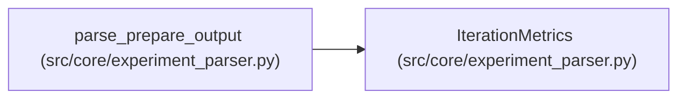

# IterationMetrics

**Location:** `src/core/experiment_parser.py:48`
**Kind:** Class
**Bases:** —
**Module:** [experiment_parser](../modules/experiment_parser.md)

**Decorators:** `@dataclass`

## Description

Parsed metrics from a single prepare.py run.

## Attributes

| Name | Type | Default | Description |
|------|------|---------|-------------|
| `status` | `str` | `'unknown'` | — |
| `primary_metric` | `Optional[float]` | `None` | — |
| `metric_name` | `Optional[str]` | `None` | — |
| `direction` | `str` | `'higher_is_better'` | — |
| `training_gates_passed` | `bool` | `False` | — |
| `all_gates_passed` | `bool` | `False` | — |
| `training_time_s` | `Optional[float]` | `None` | — |
| `extra` | `Dict[str, Any]` | `field(default_factory=dict)` | — |

## Methods

| Method | Signature | Decorators | Description |
|--------|-----------|------------|-------------|
| `to_dict` | `() -> Dict[str, Any]` | — | — |

## Relationships

<!-- Auto-generated relationship summary. Do not edit by hand. -->

### Summary

| Module | Methods | Attributes |
|---|---:|---|
| [experiment_parser](../modules/experiment_parser.md) | 1 | `all_gates_passed`, `direction`, `extra`, `metric_name`, `primary_metric`, `status`, `training_gates_passed`, `training_time_s` |

### References

| Reference | Kind | Source | Call sites |
|---|---|---|---:|
| `parse_prepare_output` | call | [experiment_parser](../modules/experiment_parser.md) | 2 |
| `parse_prepare_output` | type_reference | [experiment_parser](../modules/experiment_parser.md) | — |
