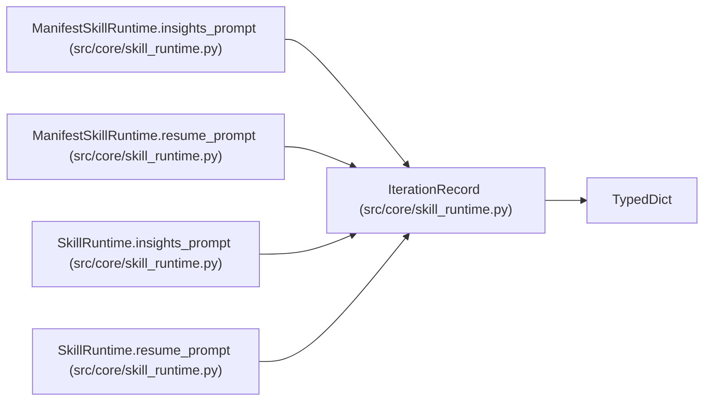

# IterationRecord

**Location:** `src/core/skill_runtime.py:90`
**Kind:** Class
**Bases:** `TypedDict`
**Module:** [skill_runtime](../modules/skill_runtime.md)

## Description

Alias over the iteration dict ``StateStore.get_iteration`` returns
(research_id, iteration, primary_metric, metric_name, decision,
config_snapshot, metrics_json, ...).

## Attributes

*No annotated attributes found.*

## Methods

*No public methods. Inherits from base classes.*

## Relationships

<!-- Auto-generated relationship summary. Do not edit by hand. -->

### Summary

| Module | Methods | Attributes |
|---|---:|---|
| [skill_runtime](../modules/skill_runtime.md) | 0 | — |

### Structure

| Kind | Entity | Module |
|---|---|---|
| Base | `TypedDict` | — |

### References

| Reference | Kind | Source | Call sites |
|---|---|---|---:|
| `ManifestSkillRuntime.insights_prompt` | type_reference | [skill_runtime](../modules/skill_runtime.md) | — |
| `ManifestSkillRuntime.resume_prompt` | type_reference | [skill_runtime](../modules/skill_runtime.md) | — |
| `SkillRuntime.insights_prompt` | type_reference | [skill_runtime](../modules/skill_runtime.md) | — |
| `SkillRuntime.resume_prompt` | type_reference | [skill_runtime](../modules/skill_runtime.md) | — |
