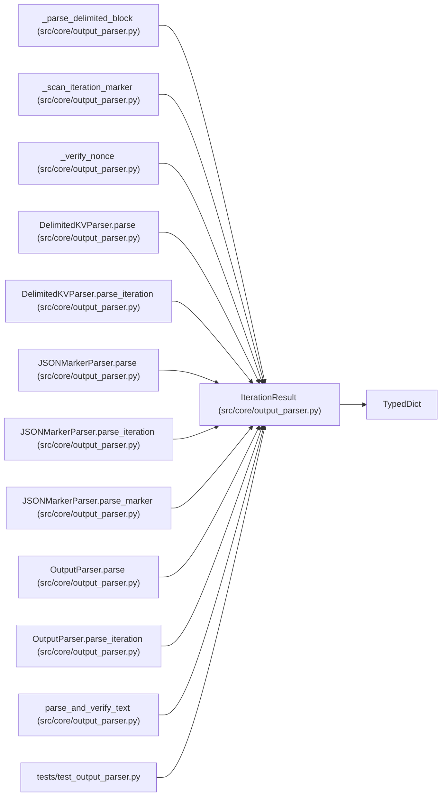

# IterationResult

**Location:** `src/core/output_parser.py:485`
**Kind:** Class
**Bases:** `TypedDict`
**Module:** [output_parser](../modules/output_parser.md)

## Description

Structured result of parsing one experiment output.

Alias over the flat dict shape ``IterationMetrics.to_dict()`` produces
(``experiment_parser.py``). ``total=False`` because every key is optional
in practice — a failure block omits ``primary_metric``, an absent marker
omits everything. Callers continue to read these via ``dict.get(...)``.

## Attributes

| Name | Type | Presence | Description |
|------|------|----------|-------------|
| `status` | `str` | *optional* | — |
| `primary_metric` | `Optional[float]` | *optional* | — |
| `metric_name` | `Optional[str]` | *optional* | — |
| `direction` | `str` | *optional* | — |
| `training_gates_passed` | `bool` | *optional* | — |
| `all_gates_passed` | `bool` | *optional* | — |
| `training_time_s` | `Optional[float]` | *optional* | — |
| `metrics_verification` | `Optional[str]` | *optional* | — |

## Methods

*No public methods. Inherits from base classes.*

## Relationships

<!-- Auto-generated relationship summary. Do not edit by hand. -->

### Summary

| Module | Methods | Attributes |
|---|---:|---|
| [output_parser](../modules/output_parser.md) | 0 | `all_gates_passed`, `direction`, `metric_name`, `metrics_verification`, `primary_metric`, `status`, `training_gates_passed`, `training_time_s` |

### Structure

| Kind | Entity | Module |
|---|---|---|
| Base | `TypedDict` | — |

### References

| Reference | Kind | Source | Call sites |
|---|---|---|---:|
| `_parse_delimited_block` | type_reference | [output_parser](../modules/output_parser.md) | — |
| `_scan_iteration_marker` | type_reference | [output_parser](../modules/output_parser.md) | — |
| `_verify_nonce` | type_reference | [output_parser](../modules/output_parser.md) | — |
| `DelimitedKVParser.parse` | type_reference | [output_parser](../modules/output_parser.md) | — |
| `DelimitedKVParser.parse_iteration` | type_reference | [output_parser](../modules/output_parser.md) | — |
| `JSONMarkerParser.parse` | type_reference | [output_parser](../modules/output_parser.md) | — |
| `JSONMarkerParser.parse_iteration` | type_reference | [output_parser](../modules/output_parser.md) | — |
| `JSONMarkerParser.parse_marker` | type_reference | [output_parser](../modules/output_parser.md) | — |
| `OutputParser.parse` | type_reference | [output_parser](../modules/output_parser.md) | — |
| `OutputParser.parse_iteration` | type_reference | [output_parser](../modules/output_parser.md) | — |
| `parse_and_verify_text` | type_reference | [output_parser](../modules/output_parser.md) | — |
| `test_output_parser` | import | [test_output_parser](../modules/test_output_parser.md) | — |
