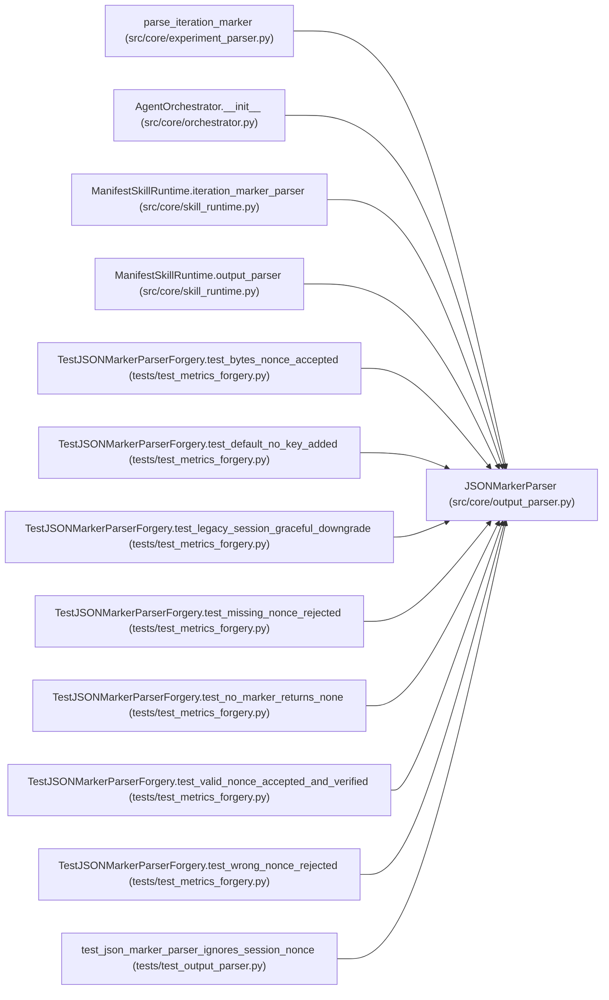

# JSONMarkerParser

**Location:** `src/core/output_parser.py:599`
**Kind:** Class
**Bases:** —
**Module:** [output_parser](../modules/output_parser.md)

## Description

Parse an ``ITERATION_RESULT:`` JSON line from agent output.

Extracted verbatim (P1-012) from ``experiment_parser.parse_iteration_marker``;
the module-level function is now a thin facade over this class. The body is
unchanged — scan-past-malformed-JSON and in-place gate-alias normalization
are preserved bit-for-bit. The X-002 parity fixtures gate this.

``parse_iteration`` is the primary entry point (matches the protocol);
``parse_marker`` is the historical name kept as an alias so
``experiment_parser.parse_iteration_marker`` can delegate without rename.

## Attributes

*No annotated attributes found.*

## Methods

| Method | Signature | Decorators | Description |
|--------|-----------|------------|-------------|
| `__init__` | `(marker_prefix: str = _ITERATION_MARKER) -> None` | — | — |
| `parse` | `(raw_output: str) -> Optional[IterationResult]` | — | KV-block parsing is not this parser's concern. |
| `parse_iteration` | `(text: str, *, session_nonce: Optional[bytes] = None, config_snapshot: Optional[str] = None, nonce_field: Optional[str] = None, require_signed_metrics: bool = False) -> Optional[IterationResult]` | — | Scan ``text`` line-by-line for an ``ITERATION_RESULT:`` JSON marker. |
| `parse_marker` | `(text: str) -> Optional[IterationResult]` | — | Historical alias for :meth:`parse_iteration` (no nonce kwarg). |

## Relationships

<!-- Auto-generated relationship summary. Do not edit by hand. -->

### Summary

| Module | Methods | Attributes |
|---|---:|---|
| [output_parser](../modules/output_parser.md) | 4 | — |

### References

| Reference | Kind | Source | Call sites |
|---|---|---|---:|
| `parse_iteration_marker` | call | [experiment_parser](../modules/experiment_parser.md) | 1 |
| `AgentOrchestrator.__init__` | call | [orchestrator](../modules/orchestrator.md) | 1 |
| `ManifestSkillRuntime.iteration_marker_parser` | call | [skill_runtime](../modules/skill_runtime.md) | 1 |
| `ManifestSkillRuntime.output_parser` | call | [skill_runtime](../modules/skill_runtime.md) | 1 |
| `TestJSONMarkerParserForgery.test_bytes_nonce_accepted` | call | [test_metrics_forgery](../modules/test_metrics_forgery.md) | 1 |
| `TestJSONMarkerParserForgery.test_default_no_key_added` | call | [test_metrics_forgery](../modules/test_metrics_forgery.md) | 1 |
| `TestJSONMarkerParserForgery.test_legacy_session_graceful_downgrade` | call | [test_metrics_forgery](../modules/test_metrics_forgery.md) | 1 |
| `TestJSONMarkerParserForgery.test_missing_nonce_rejected` | call | [test_metrics_forgery](../modules/test_metrics_forgery.md) | 1 |
| `TestJSONMarkerParserForgery.test_no_marker_returns_none` | call | [test_metrics_forgery](../modules/test_metrics_forgery.md) | 1 |
| `TestJSONMarkerParserForgery.test_valid_nonce_accepted_and_verified` | call | [test_metrics_forgery](../modules/test_metrics_forgery.md) | 1 |
| `TestJSONMarkerParserForgery.test_wrong_nonce_rejected` | call | [test_metrics_forgery](../modules/test_metrics_forgery.md) | 1 |
| `test_json_marker_parser_ignores_session_nonce` | call | [test_output_parser](../modules/test_output_parser.md) | 1 |

> References: showing 12 of 15 logical references; 3 omitted by the 12-row generated summary limit.
