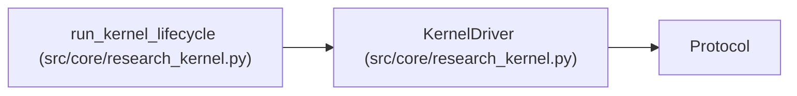

# KernelDriver

**Location:** `src/core/research_kernel.py:320`
**Kind:** Class
**Bases:** `Protocol`
**Module:** [research_kernel](../modules/research_kernel.md)

## Description

What a harness must provide to run a research lifecycle.

Provider conversation, tool serialization, context compaction, and
model retry behavior stay behind this boundary; the kernel sees only
the stable ``AttemptResult`` value contract.

## Attributes

*No annotated attributes found.*

## Methods

| Method | Signature | Decorators | Description |
|--------|-----------|------------|-------------|
| `run_attempt` | `(plan: AttemptPlan, *, attempt_index: int, context: Mapping[str, Any]) -> AttemptResult` | — | — |

## Relationships

<!-- Auto-generated relationship summary. Do not edit by hand. -->

### Summary

| Module | Methods | Attributes |
|---|---:|---|
| [research_kernel](../modules/research_kernel.md) | 1 | — |

### Structure

| Kind | Entity | Module |
|---|---|---|
| Base | `Protocol` | — |

### References

| Reference | Kind | Source | Call sites |
|---|---|---|---:|
| `run_kernel_lifecycle` | type_reference | [research_kernel](../modules/research_kernel.md) | — |
