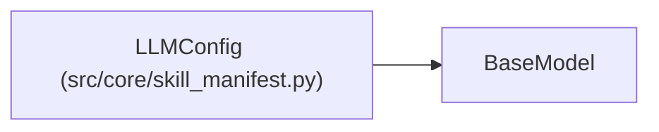

# LLMConfig

**Location:** `src/core/skill_manifest.py:115`
**Kind:** Pydantic model
**Bases:** `BaseModel`
**Module:** [skill_manifest](../modules/skill_manifest.md)

## Description

LLM tier routing (ARC-011 §9 ``llm``).

## Model Configuration

| Setting | Value | Source |
|---------|-------|--------|
| `extra` | `'forbid'` | model_config |

## Attributes

| Name | Type | Wire name | Required | Nullable | Default | Constraints | Examples | Description |
|------|------|-----------|----------|----------|---------|-------------|-------------|----------|
| `provider` | `str` | `provider` | Yes | No | — | — | — | Provider id (e.g. ``anthropic``, ``router``). |
| `primary_model` | `str` | `primary_model` | Yes | No | — | — | — | — |
| `insight_model` | `Optional[str]` | `insight_model` | No | Yes | `None` | — | — | Smaller model used for the insights summarization pass. |
| `max_output_tokens` | `int` | `max_output_tokens` | No | No | `8192` | ge=1 | — | — |
| `system_prompt` | `str` | `system_prompt` | No | No | `'SKILL.md'` | — | — | — |
| `required_native_tool_use` | `bool` | `required_native_tool_use` | No | No | `True` | — | — | — |
| `required_system_prompt` | `bool` | `required_system_prompt` | No | No | `True` | — | — | — |
| `required_max_context_tokens` | `Optional[int]` | `required_max_context_tokens` | No | Yes | `None` | ge=1 | — | — |

## Methods

*No public methods. Inherits from base classes.*

## Relationships

<!-- Auto-generated relationship summary. Do not edit by hand. -->

### Summary

| Module | Methods | Attributes |
|---|---:|---|
| [skill_manifest](../modules/skill_manifest.md) | 0 | `insight_model`, `max_output_tokens`, `primary_model`, `provider`, `required_max_context_tokens`, `required_native_tool_use`, `required_system_prompt`, `system_prompt` |

### Structure

| Kind | Entity | Module |
|---|---|---|
| Base | `BaseModel` | — |
