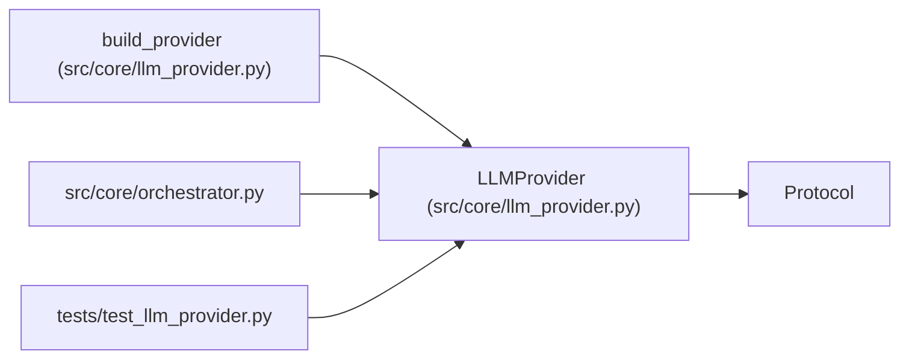

# LLMProvider

**Location:** `src/core/llm_provider.py:283`
**Kind:** Class
**Bases:** `Protocol`
**Module:** [llm_provider](../modules/llm_provider.md)

## Description

The provider-agnostic LLM contract (ARC-011 P1-001, X-005 spike §4).

A concrete provider (``AnthropicProvider`` in P1-002, ``OpenAIProvider`` in
P4-007) implements this surface. The orchestrator loop (P1-004) is wired to
accept any ``LLMProvider`` and owns retry/backoff via ``classify_error``.

## Attributes

| Name | Type | Default | Description |
|------|------|---------|-------------|
| `name` | `str` | *required* | — |

## Methods

| Method | Signature | Decorators | Description |
|--------|-----------|------------|-------------|
| `messages_create` | *(async)* `(*, model: str, system: str, messages: list[Message], tools: list[ToolDef], max_tokens: int, temperature: float \| None = None, stop_sequences: list[str] \| None = None) -> ProviderResponse` | — | Run one model turn (replaces ``messages.create``). |
| `complete` | *(async)* `(*, model: str, prompt: str, max_tokens: int, system: str \| None = None) -> str` | — | One-shot text completion (insights / Haiku path). |
| `stream` | *(async)* `(**kwargs: Any) -> AsyncIterator[StreamDelta]` | — | Token streaming (OPTIONAL in v1; D-stream). |
| `estimate_cost` | `(model: str, usage: Usage) -> float` | — | Per-provider, per-model USD cost for a call (→ P1-003). |
| `capabilities` | `() -> ProviderCapabilities` | — | Static capability advertisement (→ P4-009 / router P4-010). |
| `classify_error` | `(exc: Exception) -> ErrorClass` | — | Classify an exception for loop-owned retry (→ R4 / D-retry). |

## Relationships

<!-- Auto-generated relationship summary. Do not edit by hand. -->

### Summary

| Module | Methods | Attributes |
|---|---:|---|
| [llm_provider](../modules/llm_provider.md) | 6 | `name` |

### Structure

| Kind | Entity | Module |
|---|---|---|
| Base | `Protocol` | — |

### References

| Reference | Kind | Source | Call sites |
|---|---|---|---:|
| `build_provider` | type_reference | [llm_provider](../modules/llm_provider.md) | — |
| `orchestrator` | import | [orchestrator](../modules/orchestrator.md) | — |
| `test_llm_provider` | import | [test_llm_provider](../modules/test_llm_provider.md) | — |
