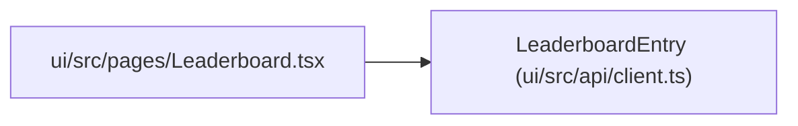

# LeaderboardEntry

**Location:** `ui/src/api/client.ts:536`
**Kind:** Class
**Bases:** —
**Module:** [client](../modules/client.md)

## Description

_Auto-generated from `LeaderboardEntry` in `ui/src/api/client.ts`._

## Attributes

| Name | Type | Required | Default | Description |
|------|------|----------|---------|-------------|
| `research_id` | `string` | Yes | — | — |
| `subject_id` | `string \| null` | Yes | — | — |
| `variant` | `string \| null` | Yes | — | — |
| `tag` | `string \| null` | Yes | — | — |
| `status` | `string` | Yes | — | — |
| `best_metric` | `number \| null` | Yes | — | — |
| `metric_name` | `string \| null` | Yes | — | — |
| `best_iteration` | `number \| null` | Yes | — | — |
| `iterations` | `number` | Yes | — | — |
| `total_api_cost_usd` | `number` | Yes | — | — |
| `started_at` | `string \| null` | Yes | — | — |
| `completed_at` | `string \| null` | Yes | — | — |

## Methods

*No public methods. Inherits from base classes.*

## Relationships

<!-- Auto-generated relationship summary. Do not edit by hand. -->

### Summary

| Module | Methods | Attributes |
|---|---:|---|
| [client](../modules/client.md) | 0 | `best_iteration`, `best_metric`, `completed_at`, `iterations`, `metric_name`, `research_id`, `started_at`, `status`, `subject_id`, `tag`, `total_api_cost_usd`, `variant` |

### References

| Reference | Kind | Source | Call sites |
|---|---|---|---:|
| `Leaderboard` | import | [Leaderboard](../modules/Leaderboard.md) | — |
