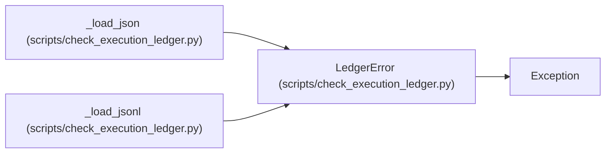

# LedgerError

**Location:** `scripts/check_execution_ledger.py:50`
**Kind:** Class
**Bases:** `Exception`
**Module:** [check_execution_ledger](../modules/check_execution_ledger.md)

## Description

Raised for structural problems that make the ledger uninterpretable.

## Attributes

*No annotated attributes found.*

## Methods

*No public methods. Inherits from base classes.*

## Relationships

<!-- Auto-generated relationship summary. Do not edit by hand. -->

### Summary

| Module | Methods | Attributes |
|---|---:|---|
| [check_execution_ledger](../modules/check_execution_ledger.md) | 0 | — |

### Structure

| Kind | Entity | Module |
|---|---|---|
| Base | `Exception` | — |

### References

| Reference | Kind | Source | Call sites |
|---|---|---|---:|
| `_load_json` | call | [check_execution_ledger](../modules/check_execution_ledger.md) | 2 |
| `_load_jsonl` | call | [check_execution_ledger](../modules/check_execution_ledger.md) | 2 |
