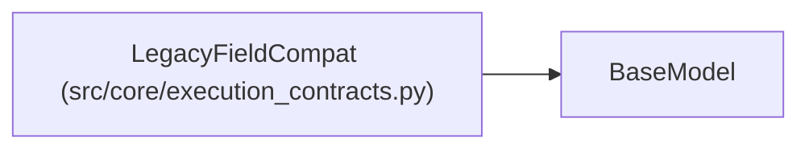

# LegacyFieldCompat

**Location:** `src/core/execution_contracts.py:1161`
**Kind:** Pydantic model
**Bases:** `BaseModel`
**Module:** [execution_contracts](../modules/execution_contracts.md)

## Description

One legacy surface's disposition under the v1 contracts.

## Model Configuration

| Setting | Value | Source |
|---------|-------|--------|
| `extra` | `'forbid'` | model_config |

## Attributes

| Name | Type | Wire name | Required | Nullable | Default | Constraints | Examples | Description |
|------|------|-----------|----------|----------|---------|-------------|-------------|----------|
| `legacy_field` | `str` | `legacy_field` | Yes | No | — | — | — | — |
| `disposition` | `Literal['preserved', 'rejected']` | `disposition` | Yes | No | — | — | — | — |
| `contract_field` | `Optional[str]` | `contract_field` | No | Yes | `None` | — | — | — |
| `reason` | `str` | `reason` | Yes | No | — | — | — | — |
| `rejected_when` | `Optional[str]` | `rejected_when` | No | Yes | `None` | — | — | — |

## Methods

*No public methods. Inherits from base classes.*

## Relationships

<!-- Auto-generated relationship summary. Do not edit by hand. -->

### Summary

| Module | Methods | Attributes |
|---|---:|---|
| [execution_contracts](../modules/execution_contracts.md) | 0 | `contract_field`, `disposition`, `legacy_field`, `reason`, `rejected_when` |

### Structure

| Kind | Entity | Module |
|---|---|---|
| Base | `BaseModel` | — |
