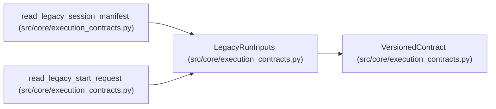

# LegacyRunInputs

**Location:** `src/core/execution_contracts.py:1285`
**Kind:** Pydantic model
**Bases:** `VersionedContract`
**Module:** [execution_contracts](../modules/execution_contracts.md)

## Description

What a legacy payload migrates into: identity, parameters, budget.

## Model Configuration

| Setting | Value | Source |
|---------|-------|--------|
| `extra` | `'forbid'` | model_config |
| `allow_inf_nan` | `False` | model_config |

## Attributes

| Name | Type | Wire name | Required | Nullable | Default | Constraints | Examples | Description |
|------|------|-----------|----------|----------|---------|-------------|-------------|----------|
| `schema_version` | `str` | `schema_version` | No | No | `LEGACY_RUN_INPUTS_SCHEMA_VERSION` | — | — | — |
| `source_schema` | `str` | `source_schema` | Yes | No | — | min_length=1 | — | — |
| `skill_id` | `str` | `skill_id` | Yes | No | — | min_length=1 | — | — |
| `subject_id` | `str` | `subject_id` | Yes | No | — | min_length=1 | — | — |
| `variant` | `str` | `variant` | Yes | No | — | min_length=1 | — | — |
| `parameters` | `dict[str, Any]` | `parameters` | No | No | factory: `dict` | — | — | — |
| `budget` | `BudgetDimensions` | `budget` | Yes | No | — | — | — | — |
| `legacy_objective_text` | `Optional[str]` | `legacy_objective_text` | No | Yes | `None` | — | — | — |
| `focus_hint` | `Optional[str]` | `focus_hint` | No | Yes | `None` | — | — | — |
| `preserved_fields` | `list[str]` | `preserved_fields` | No | No | factory: `list` | — | — | — |
| `absent_rejected_fields` | `list[str]` | `absent_rejected_fields` | No | No | factory: `list` | — | — | — |

## Methods

*No public methods. Inherits from base classes.*

## Relationships

<!-- Auto-generated relationship summary. Do not edit by hand. -->

### Summary

| Module | Methods | Attributes |
|---|---:|---|
| [execution_contracts](../modules/execution_contracts.md) | 0 | `absent_rejected_fields`, `budget`, `focus_hint`, `legacy_objective_text`, `parameters`, `preserved_fields`, `schema_version`, `skill_id`, `source_schema`, `subject_id`, `variant` |

### Structure

| Kind | Entity | Module |
|---|---|---|
| Base | `VersionedContract` | [execution_contracts](../modules/execution_contracts.md) |

### References

| Reference | Kind | Source | Call sites |
|---|---|---|---:|
| `read_legacy_session_manifest` | call | [execution_contracts](../modules/execution_contracts.md) | 1 |
| `read_legacy_session_manifest` | type_reference | [execution_contracts](../modules/execution_contracts.md) | — |
| `read_legacy_start_request` | call | [execution_contracts](../modules/execution_contracts.md) | 1 |
| `read_legacy_start_request` | type_reference | [execution_contracts](../modules/execution_contracts.md) | — |
