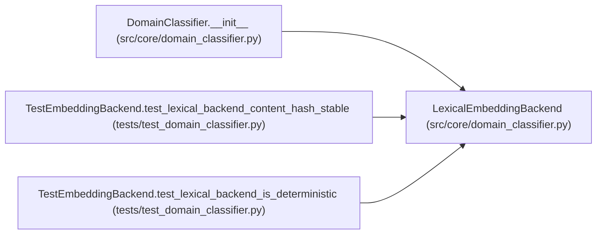

# LexicalEmbeddingBackend

**Location:** `src/core/domain_classifier.py:92`
**Kind:** Class
**Bases:** —
**Module:** [domain_classifier](../modules/domain_classifier.md)

## Description

TF-IDF over hashed word + char n-grams, cosine similarity (default).

Deterministic, offline, stdlib + numpy only. The hashing trick keeps the
model stateless (no vocabulary dict to persist); the IDF weights are
computed from a fixed background corpus built from the installed skills'
descriptions at ``DomainClassifier`` construction time.

## Attributes

*No annotated attributes found.*

## Methods

| Method | Signature | Decorators | Description |
|--------|-----------|------------|-------------|
| `__init__` | `(*, background_corpus: Optional[Sequence[str]] = None, buckets: int = _HASH_BUCKETS) -> None` | — | — |
| `dimensionality` | `() -> int` | `@property` | — |
| `content_hash` | `(text: str) -> str` | — | — |
| `embed` | `(text: str) -> Sequence[float]` | — | — |
| `_tokenize` | `(text: str) -> list[str]` | `@staticmethod` | — |
| `_features` | `(text: str) -> list[str]` | — | — |
| `_hash` | `(token: str) -> int` | `@staticmethod` | — |
| `_compute_idf` | `(corpus: Sequence[str]) -> dict[int, float]` | — | Smoothed IDF over the background corpus (the installed skills). |

## Relationships

<!-- Auto-generated relationship summary. Do not edit by hand. -->

### Summary

| Module | Methods | Attributes |
|---|---:|---|
| [domain_classifier](../modules/domain_classifier.md) | 8 | — |

### References

| Reference | Kind | Source | Call sites |
|---|---|---|---:|
| `DomainClassifier.__init__` | call | [domain_classifier](../modules/domain_classifier.md) | 1 |
| `TestEmbeddingBackend.test_lexical_backend_content_hash_stable` | call | [test_domain_classifier](../modules/test_domain_classifier.md) | 1 |
| `TestEmbeddingBackend.test_lexical_backend_is_deterministic` | call | [test_domain_classifier](../modules/test_domain_classifier.md) | 1 |
