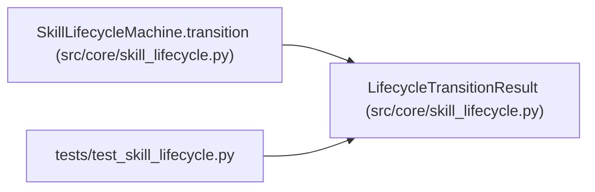

# LifecycleTransitionResult

**Location:** `src/core/skill_lifecycle.py:104`
**Kind:** Class
**Bases:** —
**Module:** [skill_lifecycle](../modules/skill_lifecycle.md)

**Decorators:** `@dataclass(frozen=True)`

## Description

Outcome of a lifecycle transition (the caller performs the side-effects).

## Attributes

| Name | Type | Default | Description |
|------|------|---------|-------------|
| `skill_id` | `str` | *required* | — |
| `from_state` | `SkillLifecycleState` | *required* | — |
| `to_state` | `SkillLifecycleState` | *required* | — |
| `event` | `SkillLifecycleEvent` | *required* | — |
| `changed` | `bool` | *required* | — |

## Methods

| Method | Signature | Decorators | Description |
|--------|-----------|------------|-------------|
| `audit_action` | `() -> str` | `@property` | The audit_events ``action`` vocabulary for this transition. |

## Relationships

<!-- Auto-generated relationship summary. Do not edit by hand. -->

### Summary

| Module | Methods | Attributes |
|---|---:|---|
| [skill_lifecycle](../modules/skill_lifecycle.md) | 1 | `changed`, `event`, `from_state`, `skill_id`, `to_state` |

### References

| Reference | Kind | Source | Call sites |
|---|---|---|---:|
| `SkillLifecycleMachine.transition` | call | [skill_lifecycle](../modules/skill_lifecycle.md) | 1 |
| `SkillLifecycleMachine.transition` | type_reference | [skill_lifecycle](../modules/skill_lifecycle.md) | — |
| `test_skill_lifecycle` | import | [test_skill_lifecycle](../modules/test_skill_lifecycle.md) | — |
