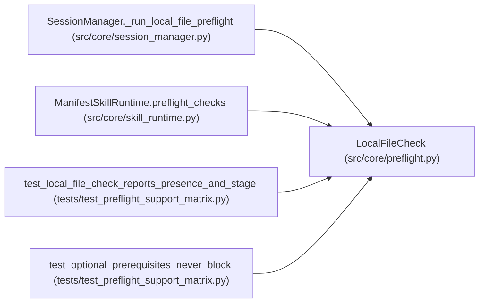

# LocalFileCheck

**Location:** `src/core/preflight.py:105`
**Kind:** Class
**Bases:** —
**Module:** [preflight](../modules/preflight.md)

**Decorators:** `@dataclass`

## Description

A declared local-file prerequisite (no transport involved).

``stage`` decides when it runs: ``source`` prerequisites are evaluated
before the skill bootstrap renders the workspace; ``generated`` outputs
after it (their earlier absence is never a failure).

## Attributes

| Name | Type | Default | Description |
|------|------|---------|-------------|
| `name` | `str` | *required* | — |
| `path` | `str` | *required* | — |
| `required` | `bool` | `True` | — |
| `stage` | `str` | `'source'` | — |
| `root` | `Optional[str]` | `None` | — |

## Methods

| Method | Signature | Decorators | Description |
|--------|-----------|------------|-------------|
| `check` | *(async)* `(client: httpx.AsyncClient \| None = None) -> dict[str, Any]` | — | — |

## Relationships

<!-- Auto-generated relationship summary. Do not edit by hand. -->

### Summary

| Module | Methods | Attributes |
|---|---:|---|
| [preflight](../modules/preflight.md) | 1 | `name`, `path`, `required`, `root`, `stage` |

### References

| Reference | Kind | Source | Call sites |
|---|---|---|---:|
| `SessionManager._run_local_file_preflight` | call | [session_manager](../modules/session_manager.md) | 1 |
| `ManifestSkillRuntime.preflight_checks` | call | [skill_runtime](../modules/skill_runtime.md) | 1 |
| `test_local_file_check_reports_presence_and_stage` | call | [test_preflight_support_matrix](../modules/test_preflight_support_matrix.md) | 2 |
| `test_optional_prerequisites_never_block` | call | [test_preflight_support_matrix](../modules/test_preflight_support_matrix.md) | 1 |
