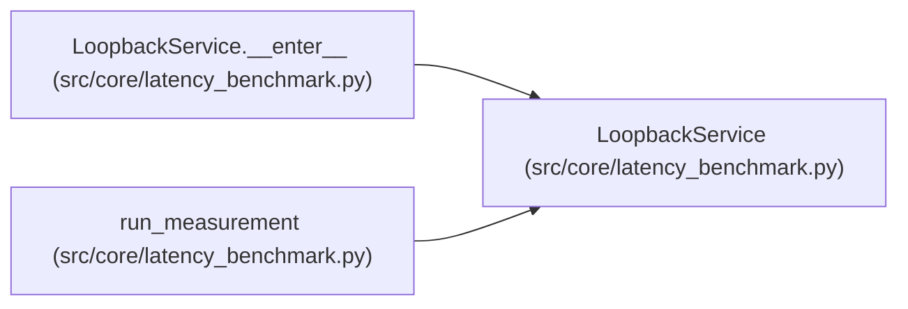

# LoopbackService

**Location:** `src/core/latency_benchmark.py:123`
**Kind:** Class
**Bases:** —
**Module:** [latency_benchmark](../modules/latency_benchmark.md)

## Description

The agent-owned loopback HTTP service under measurement.

## Attributes

*No annotated attributes found.*

## Methods

| Method | Signature | Decorators | Description |
|--------|-----------|------------|-------------|
| `__init__` | `(variant: Callable[[tuple[tuple[str, float], ...], str], float], items: tuple[tuple[str, float], ...]) -> None` | — | — |
| `address` | `() -> tuple[str, int]` | `@property` | — |
| `__enter__` | `() -> 'LoopbackService'` | — | — |
| `__exit__` | `(*exc: Any) -> None` | — | — |

## Relationships

<!-- Auto-generated relationship summary. Do not edit by hand. -->

### Summary

| Module | Methods | Attributes |
|---|---:|---|
| [latency_benchmark](../modules/latency_benchmark.md) | 4 | — |

### References

| Reference | Kind | Source | Call sites |
|---|---|---|---:|
| `LoopbackService.__enter__` | type_reference | [latency_benchmark](../modules/latency_benchmark.md) | — |
| `run_measurement` | call | [latency_benchmark](../modules/latency_benchmark.md) | 1 |
