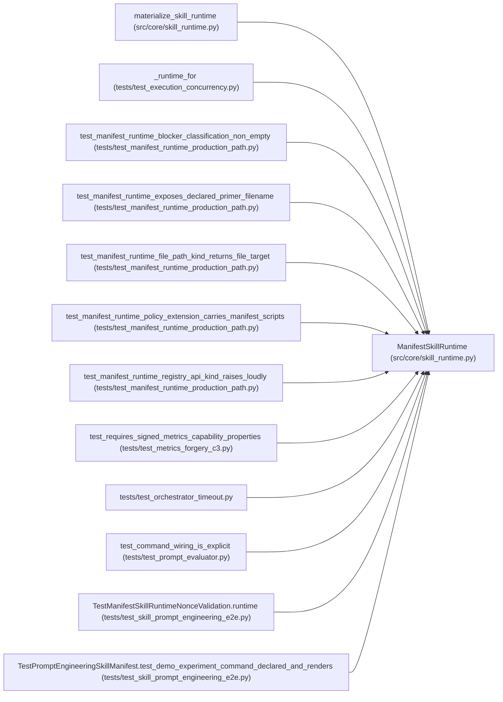

# ManifestSkillRuntime

**Location:** `src/core/skill_runtime.py:350`
**Kind:** Class
**Bases:** —
**Module:** [skill_runtime](../modules/skill_runtime.md)

## Description

A ``SkillRuntime`` driven entirely by a ``ResearchSkillManifest`` (P2-007).

Holds a reference to the orchestrator (which owns the prompt-builder,
skill-loader, resume-generator, and trial-identity helpers) and reaches every
domain-specific decision through the manifest. ``materialize_skill_runtime``
constructs this when ``config.skill_id`` resolves in the registry.

## Attributes

*No annotated attributes found.*

## Methods

| Method | Signature | Decorators | Description |
|--------|-----------|------------|-------------|
| `__init__` | `(manifest: Any, orchestrator: Any) -> None` | — | — |
| `skill_id` | `() -> str` | `@property` | — |
| `manifest` | `() -> Any` | `@property` | The validated ``ResearchSkillManifest`` (P2 multi-seed significance |
| `skill_version` | `() -> str` | `@property` | — |
| `primer_filename` | `() -> str` | `@property` | The manifest-declared system-prompt primer file |
| `requires_signed_metrics` | `() -> bool` | `@property` | W11 enforcement flag (``output_parser.require_signed_metrics``). |
| `nonce_field` | `() -> str` | `@property` | The echoed-nonce field name (``output_parser.nonce_field``, |
| `system_prompt` | `() -> str` | — | Assemble the system prompt from the manifest's primer file |
| `blocker_classification` | `() -> dict[str, Any]` | — | G3: the manifest's ``blocker_classification`` section (ARC-011 |
| `evaluator_command_params` | `(config: 'ResearchConfig') -> dict[str, str]` | — | Server-owned argv values; execution must override agent-supplied flags. |
| `experiment_command` | `(config: 'ResearchConfig') -> str` | — | Resolve the manifest command with explicit session evaluator wiring. |
| `demo_experiment_command` | `(config: 'ResearchConfig') -> str` | — | Render ``prompt.demo_experiment_command`` for this session |
| `iteration_marker_prefix` | `() -> str` | — | — |
| `directive_prompt` | `(config: 'ResearchConfig') -> str` | — | Build the session-directing user prompt from the manifest. |
| `resume_prompt` | `(config: 'ResearchConfig', parent: SessionRecord, parent_iterations: list[IterationRecord]) -> str` | — | Build the continuation prompt for a resumed session. |
| `command_policy_extension` | `() -> CommandPolicyExtension` | — | Read the allowed scripts/executables/files from the manifest's |
| `parse_iteration` | `(raw_output: str, *, session_nonce: Optional[bytes] = None, config_snapshot: Optional[str] = None) -> Optional[dict[str, Any]]` | — | — |
| `marker_file_paths` | `(config: 'ResearchConfig') -> list[Path]` | — | Fallback iteration sources from the manifest's |
| `phase_plan` | `() -> list[Phase]` | — | Read the phase list from the manifest's ``phase_plan`` section, |
| `phase_advancement_rule` | `(phase_id: str) -> AdvancementRule` | — | Read per-phase evidence keys from the manifest. The hybrid completion |
| `trial_identity` | `(config: 'ResearchConfig', *, command: str, config_snapshot: Optional[str] = None, planned_trial: Optional[dict] = None) -> dict` | — | — |
| `preflight_checks` | `() -> list['PreflightCheck']` | — | Build preflight checks from the manifest's ``preflight`` section. |
| `execution_concurrency` | `() -> int` | — | The manifest's ``execution.concurrency`` (default 1 = sequential). |
| `promotion_target` | `() -> 'PromotionTarget'` | — | Build the development-scope ``PromotionTarget`` from the manifest's |
| `output_parser` | `() -> 'OutputParser'` | — | — |
| `iteration_marker_parser` | `() -> 'OutputParser'` | — | — |
| `insights_prompt` | `(session: SessionRecord, iterations: list[IterationRecord]) -> str` | — | — |
| `research_resume_path` | `(config: 'ResearchConfig') -> Path` | — | — |
| `generate_research_resume` | `(config: 'ResearchConfig', store: 'StateStore') -> str` | — | — |
| `structured_hpo_plan` | `(config: 'ResearchConfig') -> Optional[StructuredHPOPlan]` | — | — |
| `list_subjects` | `() -> list[SubjectDescriptor]` | — | — |
| `list_variants` | `(subject_id: str) -> list[VariantDescriptor]` | — | — |

## Relationships

<!-- Auto-generated relationship summary. Do not edit by hand. -->

### Summary

| Module | Methods | Attributes |
|---|---:|---|
| [skill_runtime](../modules/skill_runtime.md) | 32 | — |

### References

| Reference | Kind | Source | Call sites |
|---|---|---|---:|
| `materialize_skill_runtime` | call | [skill_runtime](../modules/skill_runtime.md) | 1 |
| `_runtime_for` | call | [test_execution_concurrency](../modules/test_execution_concurrency.md) | 1 |
| `test_manifest_runtime_blocker_classification_non_empty` | call | [test_manifest_runtime_production_path](../modules/test_manifest_runtime_production_path.md) | 1 |
| `test_manifest_runtime_exposes_declared_primer_filename` | call | [test_manifest_runtime_production_path](../modules/test_manifest_runtime_production_path.md) | 1 |
| `test_manifest_runtime_file_path_kind_returns_file_target` | call | [test_manifest_runtime_production_path](../modules/test_manifest_runtime_production_path.md) | 1 |
| `test_manifest_runtime_policy_extension_carries_manifest_scripts` | call | [test_manifest_runtime_production_path](../modules/test_manifest_runtime_production_path.md) | 1 |
| `test_manifest_runtime_registry_api_kind_raises_loudly` | call | [test_manifest_runtime_production_path](../modules/test_manifest_runtime_production_path.md) | 2 |
| `test_requires_signed_metrics_capability_properties` | call | [test_metrics_forgery_c3](../modules/test_metrics_forgery_c3.md) | 1 |
| `test_orchestrator_timeout` | import | [test_orchestrator_timeout](../modules/test_orchestrator_timeout.md) | — |
| `test_command_wiring_is_explicit` | call | [test_prompt_evaluator](../modules/test_prompt_evaluator.md) | 1 |
| `TestManifestSkillRuntimeNonceValidation.runtime` | call | [test_skill_prompt_engineering_e2e](../modules/test_skill_prompt_engineering_e2e.md) | 1 |
| `TestPromptEngineeringSkillManifest.test_demo_experiment_command_declared_and_renders` | call | [test_skill_prompt_engineering_e2e](../modules/test_skill_prompt_engineering_e2e.md) | 1 |

> References: showing 12 of 15 logical references; 3 omitted by the 12-row generated summary limit.
