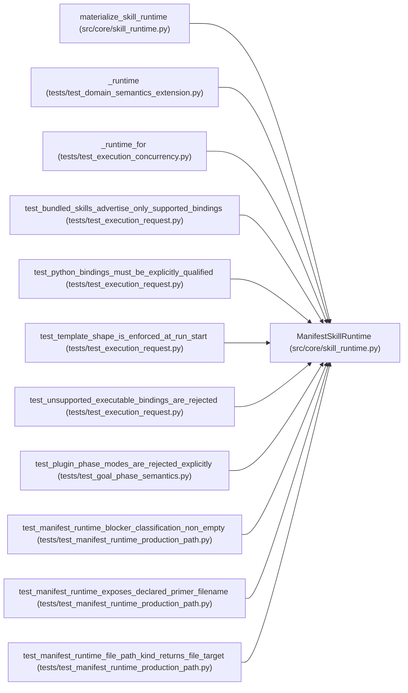

# ManifestSkillRuntime

**Location:** `src/core/skill_runtime.py:394`
**Kind:** Class
**Bases:** —
**Module:** [skill_runtime](../modules/skill_runtime.md)

## Description

A ``SkillRuntime`` driven entirely by a ``ResearchSkillManifest`` (P2-007).

Holds the host's explicit ``SkillHostServices`` (prompt material, resume
reads, and contract blocks — never orchestrator-private helpers) and
reaches every domain-specific decision through the manifest.
``materialize_skill_runtime`` constructs this when ``config.skill_id``
resolves in the registry.

## Attributes

*No annotated attributes found.*

## Methods

| Method | Signature | Decorators | Description |
|--------|-----------|------------|-------------|
| `__init__` | `(manifest: Any, host: 'SkillHostServices') -> None` | — | — |
| `skill_id` | `() -> str` | `@property` | — |
| `manifest` | `() -> Any` | `@property` | The validated ``ResearchSkillManifest`` (P2 multi-seed significance |
| `skill_version` | `() -> str` | `@property` | — |
| `primer_filename` | `() -> str` | `@property` | The manifest-declared system-prompt primer file |
| `requires_signed_metrics` | `() -> bool` | `@property` | W11 enforcement flag (``output_parser.require_signed_metrics``). |
| `nonce_field` | `() -> str` | `@property` | The echoed-nonce field name (``output_parser.nonce_field``, |
| `system_prompt` | `() -> str` | — | Assemble the system prompt from the manifest's primer file |
| `blocker_classification` | `() -> dict[str, Any]` | — | G3: the manifest's ``blocker_classification`` section (ARC-011 |
| `bound_arguments` | `(config: 'ResearchConfig') -> dict[str, str]` | — | Server-owned evaluator argv values from the manifest's declared |
| `evaluator_command_params` | `(config: 'ResearchConfig') -> dict[str, str]` | — | Server-owned argv values; execution must override agent-supplied |
| `_render_value_template` | `(template: str, config: 'ResearchConfig') -> str` | — | — |
| `_render_command` | `(template: str, config: 'ResearchConfig') -> str` | — | Render one command template with its bound arguments canonicalized. |
| `experiment_command` | `(config: 'ResearchConfig') -> str` | — | Render the manifest command with the session's bound arguments. |
| `demo_experiment_command` | `(config: 'ResearchConfig') -> str` | — | Render ``prompt.demo_experiment_command`` for this session |
| `iteration_marker_prefix` | `() -> str` | — | — |
| `directive_prompt` | `(config: 'ResearchConfig') -> str` | — | Build the session-directing user prompt from the manifest. |
| `resume_prompt` | `(config: 'ResearchConfig', parent: SessionRecord, parent_iterations: list[IterationRecord]) -> str` | — | Build the continuation prompt for a resumed session. |
| `command_policy_extension` | `() -> CommandPolicyExtension` | — | Read the allowed scripts/executables/files from the manifest's |
| `result_spec` | `() -> Any` | — | The declared result semantics (from ``output_parser``). |
| `parse_result` | `(raw_output: str) -> Optional[Any]` | — | Parse and normalize in the declared format — one contract for |
| `parse_iteration` | `(raw_output: str, *, session_nonce: Optional[bytes] = None, config_snapshot: Optional[str] = None) -> Optional[dict[str, Any]]` | — | Parse one iteration result in the DECLARED format. |
| `marker_file_paths` | `(config: 'ResearchConfig') -> list[Path]` | — | Fallback iteration sources from the manifest's |
| `phase_plan` | `() -> list[Phase]` | — | Read the phase list from the manifest's ``phase_plan`` section, |
| `_validate_plugin_advancement` | `() -> None` | — | Validate plugin phase-advancement declarations. |
| `phase_advancement_plugin` | `(phase_id: str) -> Optional[Any]` | — | The declared ``phase_advancement`` plugin entry, if any. |
| `phase_advancement_rule` | `(phase_id: str) -> AdvancementRule` | — | The declared phase rule: evidence keys and min/max observation |
| `trial_identity` | `(config: 'ResearchConfig', *, command: str, config_snapshot: Optional[str] = None, planned_trial: Optional[dict] = None) -> dict` | — | — |
| `preflight_checks` | `(*, stage: str = 'source') -> list['PreflightCheck']` | — | Build preflight checks from the manifest's ``preflight`` section. |
| `execution_concurrency` | `() -> int` | — | The manifest's ``execution.concurrency`` (default 1 = sequential). |
| `promotion_target` | `() -> 'PromotionTarget'` | — | Build the development-scope ``PromotionTarget`` from the manifest's |
| `output_parser` | `() -> 'OutputParser'` | — | — |
| `iteration_marker_parser` | `() -> 'OutputParser'` | — | — |
| `insights_prompt` | `(session: SessionRecord, iterations: list[IterationRecord]) -> str` | — | — |
| `research_resume_path` | `(config: 'ResearchConfig') -> Path` | — | — |
| `generate_research_resume` | `(config: 'ResearchConfig', store: 'StateStore') -> str` | — | — |
| `structured_hpo_plan` | `(config: 'ResearchConfig') -> Optional[StructuredHPOPlan]` | — | — |
| `list_subjects` | `() -> list[SubjectDescriptor]` | — | — |
| `list_variants` | `(subject_id: str) -> list[VariantDescriptor]` | — | — |

## Relationships

<!-- Auto-generated relationship summary. Do not edit by hand. -->

### Summary

| Module | Methods | Attributes |
|---|---:|---|
| [skill_runtime](../modules/skill_runtime.md) | 39 | — |

### References

| Reference | Kind | Source | Call sites |
|---|---|---|---:|
| `materialize_skill_runtime` | call | [skill_runtime](../modules/skill_runtime.md) | 1 |
| `_runtime` | call | [test_domain_semantics_extension](../modules/test_domain_semantics_extension.md) | 1 |
| `_runtime` | type_reference | [test_domain_semantics_extension](../modules/test_domain_semantics_extension.md) | — |
| `_runtime_for` | call | [test_execution_concurrency](../modules/test_execution_concurrency.md) | 1 |
| `test_bundled_skills_advertise_only_supported_bindings` | call | [test_execution_request](../modules/test_execution_request.md) | 1 |
| `test_python_bindings_must_be_explicitly_qualified` | call | [test_execution_request](../modules/test_execution_request.md) | 1 |
| `test_template_shape_is_enforced_at_run_start` | call | [test_execution_request](../modules/test_execution_request.md) | 1 |
| `test_unsupported_executable_bindings_are_rejected` | call | [test_execution_request](../modules/test_execution_request.md) | 1 |
| `test_plugin_phase_modes_are_rejected_explicitly` | call | [test_goal_phase_semantics](../modules/test_goal_phase_semantics.md) | 1 |
| `test_manifest_runtime_blocker_classification_non_empty` | call | [test_manifest_runtime_production_path](../modules/test_manifest_runtime_production_path.md) | 1 |
| `test_manifest_runtime_exposes_declared_primer_filename` | call | [test_manifest_runtime_production_path](../modules/test_manifest_runtime_production_path.md) | 1 |
| `test_manifest_runtime_file_path_kind_returns_file_target` | call | [test_manifest_runtime_production_path](../modules/test_manifest_runtime_production_path.md) | 1 |

> References: showing 12 of 30 logical references; 18 omitted by the 12-row generated summary limit.
