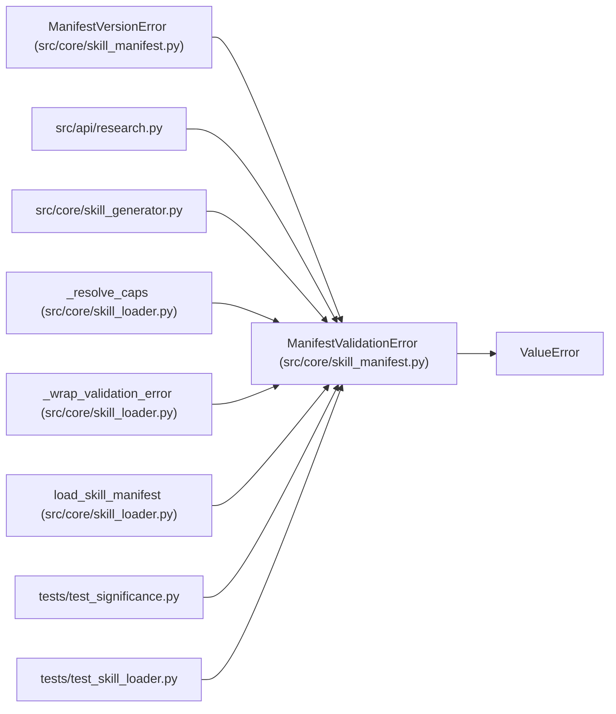

# ManifestValidationError

**Location:** `src/core/skill_manifest.py:1255`
**Kind:** Class
**Bases:** `ValueError`
**Module:** [skill_manifest](../modules/skill_manifest.md)

## Description

Raised when a manifest fails structural validation. Wraps a pydantic
``ValidationError`` with a field-specific, human-readable summary (P2-001
AC #3).

## Attributes

*No annotated attributes found.*

## Methods

| Method | Signature | Decorators | Description |
|--------|-----------|------------|-------------|
| `__init__` | `(message: str, *, errors: Optional[list[Mapping[str, Any]]] = None) -> None` | — | — |

## Relationships

<!-- Auto-generated relationship summary. Do not edit by hand. -->

### Summary

| Module | Methods | Attributes |
|---|---:|---|
| [skill_manifest](../modules/skill_manifest.md) | 1 | — |

### Structure

| Kind | Entity | Module |
|---|---|---|
| Base | `ValueError` | — |
| Subclass | `ManifestVersionError` | [skill_manifest](../modules/skill_manifest.md) |

### References

| Reference | Kind | Source | Call sites |
|---|---|---|---:|
| `research` | import | [research](../modules/research.md) | — |
| `skill_generator` | import | [skill_generator](../modules/skill_generator.md) | — |
| `_resolve_caps` | call | [skill_loader](../modules/skill_loader.md) | 3 |
| `_wrap_validation_error` | call | [skill_loader](../modules/skill_loader.md) | 1 |
| `_wrap_validation_error` | type_reference | [skill_loader](../modules/skill_loader.md) | — |
| `load_skill_manifest` | call | [skill_loader](../modules/skill_loader.md) | 3 |
| `test_significance` | import | [test_significance](../modules/test_significance.md) | — |
| `test_skill_loader` | import | [test_skill_loader](../modules/test_skill_loader.md) | — |
