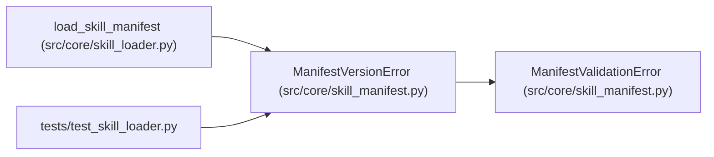

# ManifestVersionError

**Location:** `src/core/skill_manifest.py:1165`
**Kind:** Class
**Bases:** `ManifestValidationError`
**Module:** [skill_manifest](../modules/skill_manifest.md)

## Description

Raised by the loader (P2-002) for an unrecognized ``schema_version``.

## Attributes

*No annotated attributes found.*

## Methods

*No public methods. Inherits from base classes.*

## Relationships

<!-- Auto-generated relationship summary. Do not edit by hand. -->

### Summary

| Module | Methods | Attributes |
|---|---:|---|
| [skill_manifest](../modules/skill_manifest.md) | 0 | — |

### Structure

| Kind | Entity | Module |
|---|---|---|
| Base | `ManifestValidationError` | [skill_manifest](../modules/skill_manifest.md) |

### References

| Reference | Kind | Source | Call sites |
|---|---|---|---:|
| `load_skill_manifest` | call | [skill_loader](../modules/skill_loader.md) | 1 |
| `test_skill_loader` | import | [test_skill_loader](../modules/test_skill_loader.md) | — |
