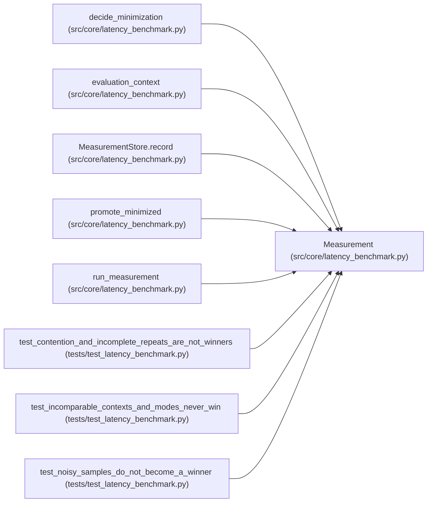

# Measurement

**Location:** `src/core/latency_benchmark.py:228`
**Kind:** Class
**Bases:** —
**Module:** [latency_benchmark](../modules/latency_benchmark.md)

**Decorators:** `@dataclass`

## Description

One variant's measured result: evidence, not a claim.

## Attributes

| Name | Type | Default | Description |
|------|------|---------|-------------|
| `variant_id` | `str` | *required* | — |
| `mode` | `str` | *required* | — |
| `context` | `dict[str, Any]` | *required* | — |
| `p_target` | `float` | `0.95` | — |
| `repeat_latencies_s` | `list[list[float]]` | `field(default_factory=list)` | — |
| `error_count` | `int` | `0` | — |
| `throughput_rps` | `float` | `0.0` | — |
| `contended` | `bool` | `False` | — |
| `contention_ratio` | `float` | `1.0` | — |

## Methods

| Method | Signature | Decorators | Description |
|--------|-----------|------------|-------------|
| `p_latencies` | `() -> list[float]` | `@property` | Per-repeat p-target latency samples. |
| `median_p_latency` | `() -> float` | `@property` | — |
| `uncertainty` | `() -> float` | `@property` | — |
| `error_rate` | `() -> float` | `@property` | — |
| `as_dict` | `() -> dict[str, Any]` | — | — |

## Relationships

<!-- Auto-generated relationship summary. Do not edit by hand. -->

### Summary

| Module | Methods | Attributes |
|---|---:|---|
| [latency_benchmark](../modules/latency_benchmark.md) | 5 | `contended`, `contention_ratio`, `context`, `error_count`, `mode`, `p_target`, `repeat_latencies_s`, `throughput_rps`, `variant_id` |

### References

| Reference | Kind | Source | Call sites |
|---|---|---|---:|
| `decide_minimization` | type_reference | [latency_benchmark](../modules/latency_benchmark.md) | — |
| `evaluation_context` | type_reference | [latency_benchmark](../modules/latency_benchmark.md) | — |
| `MeasurementStore.record` | type_reference | [latency_benchmark](../modules/latency_benchmark.md) | — |
| `promote_minimized` | type_reference | [latency_benchmark](../modules/latency_benchmark.md) | — |
| `run_measurement` | call | [latency_benchmark](../modules/latency_benchmark.md) | 1 |
| `run_measurement` | type_reference | [latency_benchmark](../modules/latency_benchmark.md) | — |
| `test_contention_and_incomplete_repeats_are_not_winners` | call | [test_latency_benchmark](../modules/test_latency_benchmark.md) | 2 |
| `test_incomparable_contexts_and_modes_never_win` | call | [test_latency_benchmark](../modules/test_latency_benchmark.md) | 1 |
| `test_noisy_samples_do_not_become_a_winner` | call | [test_latency_benchmark](../modules/test_latency_benchmark.md) | 1 |
