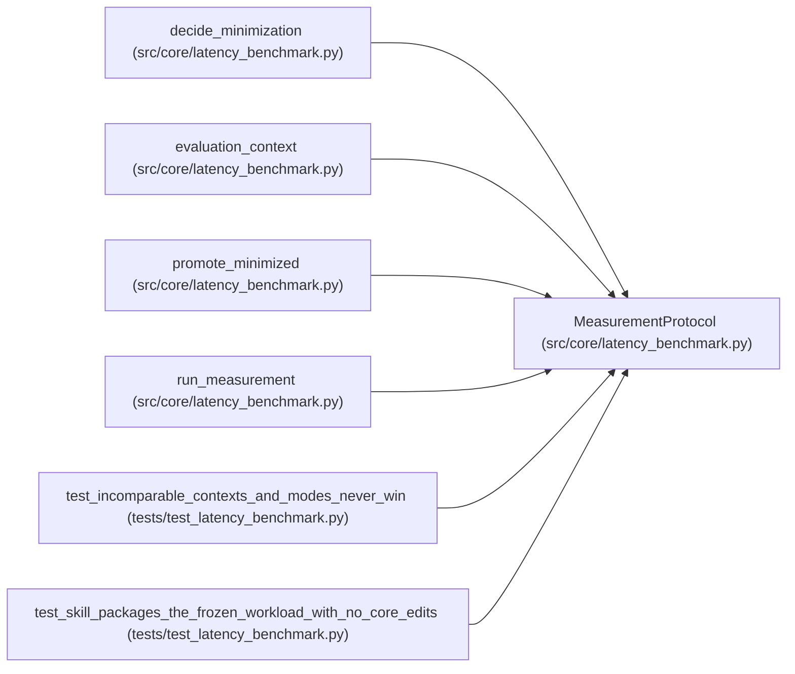

# MeasurementProtocol

**Location:** `src/core/latency_benchmark.py:156`
**Kind:** Class
**Bases:** —
**Module:** [latency_benchmark](../modules/latency_benchmark.md)

**Decorators:** `@dataclass(frozen=True)`

## Description

Frozen before comparison: mix, warmup, repeats, guardrails.

## Attributes

| Name | Type | Default | Description |
|------|------|---------|-------------|
| `protocol_id` | `str` | *required* | — |
| `warmup_requests` | `int` | `20` | — |
| `repeats` | `int` | `3` | — |
| `requests_per_repeat` | `int` | `40` | — |
| `p_target` | `float` | `0.95` | — |
| `max_error_rate` | `float` | `0.0` | — |
| `min_throughput_rps` | `float` | `0.0` | — |
| `max_uncertainty` | `float` | `0.35` | — |
| `min_improvement` | `float` | `0.1` | — |
| `resource_envelope_threads` | `int` | `8` | — |

## Methods

| Method | Signature | Decorators | Description |
|--------|-----------|------------|-------------|
| `digest` | `() -> str` | — | — |

## Relationships

<!-- Auto-generated relationship summary. Do not edit by hand. -->

### Summary

| Module | Methods | Attributes |
|---|---:|---|
| [latency_benchmark](../modules/latency_benchmark.md) | 1 | `max_error_rate`, `max_uncertainty`, `min_improvement`, `min_throughput_rps`, `p_target`, `protocol_id`, `repeats`, `requests_per_repeat`, `resource_envelope_threads`, `warmup_requests` |

### References

| Reference | Kind | Source | Call sites |
|---|---|---|---:|
| `decide_minimization` | type_reference | [latency_benchmark](../modules/latency_benchmark.md) | — |
| `evaluation_context` | type_reference | [latency_benchmark](../modules/latency_benchmark.md) | — |
| `promote_minimized` | type_reference | [latency_benchmark](../modules/latency_benchmark.md) | — |
| `run_measurement` | type_reference | [latency_benchmark](../modules/latency_benchmark.md) | — |
| `test_incomparable_contexts_and_modes_never_win` | call | [test_latency_benchmark](../modules/test_latency_benchmark.md) | 1 |
| `test_skill_packages_the_frozen_workload_with_no_core_edits` | call | [test_latency_benchmark](../modules/test_latency_benchmark.md) | 1 |
