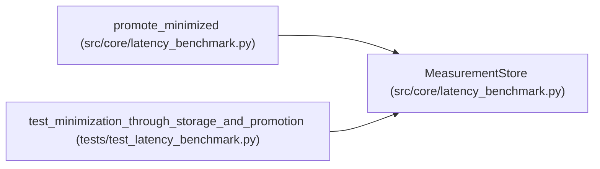

# MeasurementStore

**Location:** `src/core/latency_benchmark.py:464`
**Kind:** Class
**Bases:** —
**Module:** [latency_benchmark](../modules/latency_benchmark.md)

## Description

Storage for measurements: JSONL keyed by context digest + variant.

## Attributes

*No annotated attributes found.*

## Methods

| Method | Signature | Decorators | Description |
|--------|-----------|------------|-------------|
| `__init__` | `(path: Path) -> None` | — | — |
| `record` | `(measurement: Measurement) -> None` | — | — |
| `load` | `(*, context_digest: str, variant_id: str) -> Optional[dict[str, Any]]` | — | — |

## Relationships

<!-- Auto-generated relationship summary. Do not edit by hand. -->

### Summary

| Module | Methods | Attributes |
|---|---:|---|
| [latency_benchmark](../modules/latency_benchmark.md) | 3 | — |

### References

| Reference | Kind | Source | Call sites |
|---|---|---|---:|
| `promote_minimized` | type_reference | [latency_benchmark](../modules/latency_benchmark.md) | — |
| `test_minimization_through_storage_and_promotion` | call | [test_latency_benchmark](../modules/test_latency_benchmark.md) | 1 |
