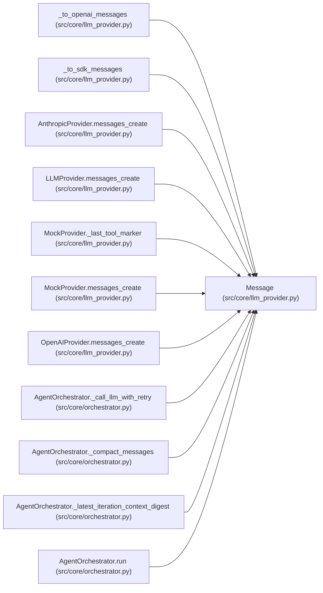

# Message

**Location:** `src/core/llm_provider.py:202`
**Kind:** Class
**Bases:** —
**Module:** [llm_provider](../modules/llm_provider.md)

**Decorators:** `@dataclass(frozen=True)`

## Description

One conversation turn (spike §4, completion #2 for content shape).

``content`` is ``str`` for plain user prompts (the orchestrator builds the
initial user message as a string, ``orchestrator.py`` ``run``) and
``list[RequestBlock]`` for assistant turns and tool-result turns. Typing it
as the union keeps P1-002 a pass-through wrapper (parity-preserving).

## Attributes

| Name | Type | Default | Description |
|------|------|---------|-------------|
| `role` | `str` | *required* | — |
| `content` | `str \| list[RequestBlock]` | *required* | — |

## Methods

*No public methods. Inherits from base classes.*

## Relationships

<!-- Auto-generated relationship summary. Do not edit by hand. -->

### Summary

| Module | Methods | Attributes |
|---|---:|---|
| [llm_provider](../modules/llm_provider.md) | 0 | `content`, `role` |

### References

| Reference | Kind | Source | Call sites |
|---|---|---|---:|
| `_to_openai_messages` | type_reference | [llm_provider](../modules/llm_provider.md) | — |
| `_to_sdk_messages` | type_reference | [llm_provider](../modules/llm_provider.md) | — |
| `AnthropicProvider.messages_create` | type_reference | [llm_provider](../modules/llm_provider.md) | — |
| `LLMProvider.messages_create` | type_reference | [llm_provider](../modules/llm_provider.md) | — |
| `MockProvider._last_tool_marker` | type_reference | [llm_provider](../modules/llm_provider.md) | — |
| `MockProvider.messages_create` | type_reference | [llm_provider](../modules/llm_provider.md) | — |
| `OpenAIProvider.messages_create` | type_reference | [llm_provider](../modules/llm_provider.md) | — |
| `AgentOrchestrator._call_llm_with_retry` | type_reference | [orchestrator](../modules/orchestrator.md) | — |
| `AgentOrchestrator._compact_messages` | call | [orchestrator](../modules/orchestrator.md) | 1 |
| `AgentOrchestrator._compact_messages` | type_reference | [orchestrator](../modules/orchestrator.md) | — |
| `AgentOrchestrator._latest_iteration_context_digest` | type_reference | [orchestrator](../modules/orchestrator.md) | — |
| `AgentOrchestrator.run` | call | [orchestrator](../modules/orchestrator.md) | 7 |

> References: showing 12 of 30 logical references; 18 omitted by the 12-row generated summary limit.
