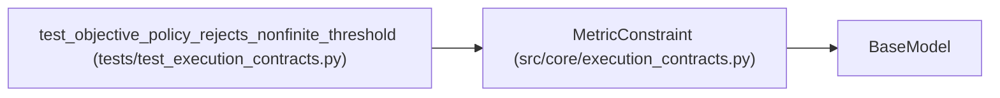

# MetricConstraint

**Location:** `src/core/execution_contracts.py:361`
**Kind:** Pydantic model
**Bases:** `BaseModel`
**Module:** [execution_contracts](../modules/execution_contracts.md)

## Description

A guardrail threshold an eligible result must satisfy.

## Model Configuration

| Setting | Value | Source |
|---------|-------|--------|
| `extra` | `'forbid'` | model_config |
| `allow_inf_nan` | `False` | model_config |

## Attributes

| Name | Type | Wire name | Required | Nullable | Default | Constraints | Examples | Description |
|------|------|-----------|----------|----------|---------|-------------|-------------|----------|
| `metric_field` | `str` | `metric_field` | Yes | No | — | min_length=1 | — | — |
| `comparator` | `Literal['<=', '>=', '<', '>', '==']` | `comparator` | Yes | No | — | — | — | — |
| `threshold` | `float` | `threshold` | Yes | No | — | — | — | — |
| `required` | `bool` | `required` | No | No | `True` | — | — | — |

## Methods

*No public methods. Inherits from base classes.*

## Relationships

<!-- Auto-generated relationship summary. Do not edit by hand. -->

### Summary

| Module | Methods | Attributes |
|---|---:|---|
| [execution_contracts](../modules/execution_contracts.md) | 0 | `comparator`, `metric_field`, `required`, `threshold` |

### Structure

| Kind | Entity | Module |
|---|---|---|
| Base | `BaseModel` | — |

### References

| Reference | Kind | Source | Call sites |
|---|---|---|---:|
| `test_objective_policy_rejects_nonfinite_threshold` | call | [test_execution_contracts](../modules/test_execution_contracts.md) | 1 |
